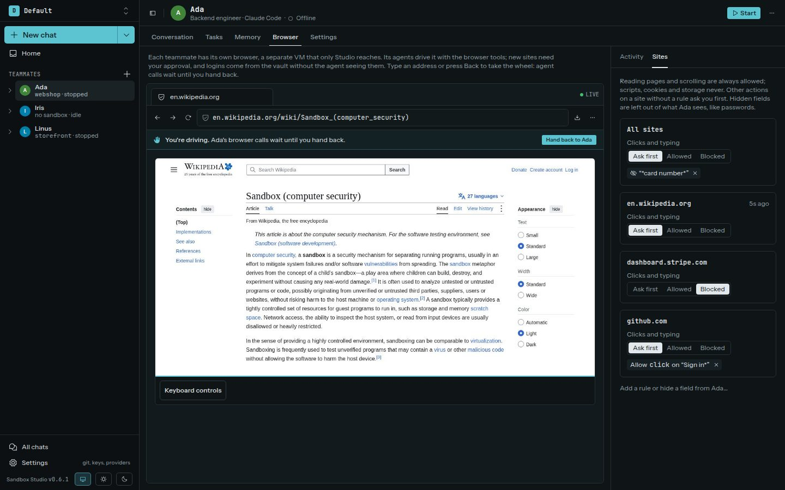

Each teammate has its own Chromium browser running in a separate microVM. Agents control it with browser tools; they do not receive a remote debugging port. Cookies and logins belong to that teammate's browser profile.

## Approve actions and access

Read-only actions such as snapshots and reading text are allowed. Opening a page still follows the sandbox's network rules. Actions that change a page, such as clicking or filling a field, ask for approval unless an allow rule matches. Uploads and downloads always ask. You can deny actions or add rules for an origin and action.

Script execution, cookie access, storage access, and page state inspection are not available to the agent tools. Password-like and marked-sensitive fields are redacted from snapshots. When you approve **Fill credential**, Studio fills a host-side secret into the page without showing the value to the agent.

Use **Live** to watch the browser. **Take over** pauses agent control so you can use the page yourself; hand control back when you are done. The Browser page also keeps an action history.

Browser network requests use the environment's network rules. When an agent drives the browser, requests use the driving sandbox's policy. See [Network rules](../network/) and [Secrets](../secrets/).

## Throwaway sessions

An agent can open a throwaway session for a task that should not leave cookies or logins behind. A throwaway session starts with an empty profile. It ends when the agent closes it, after 10 minutes without use, when the sandbox that opened it is deleted, or when the teammate's browser stops. Its cookies, storage and downloads are discarded with it. A teammate can have two at a time, across its sandboxes.

Approvals work as they do for the teammate's own browser. Approval cards name the session. While a throwaway session is open, the live view shows a session switcher with **Profile** and the open throwaway sessions, so you can watch one or take it over.
