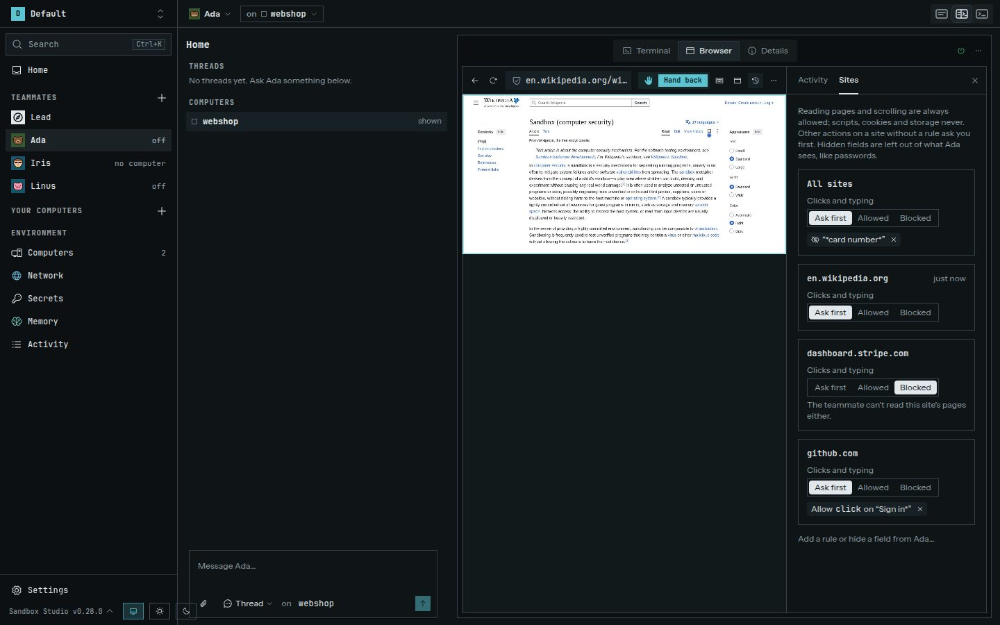

Each teammate has its own Chromium browser running in a separate microVM. Agents control it with the `studio browser` command on their computer (`studio browser open`, `snapshot`, `click`, `screenshot` and the rest; `studio browser --help` lists them); they do not receive a remote debugging port. Cookies and logins belong to that teammate's browser profile.

## Approve actions and access

Read-only actions such as snapshots and reading text are allowed. Opening a page still follows the computer's network rules. Actions that change a page, such as clicking or filling a field, ask for approval unless an allow rule matches. Uploads and downloads always ask. You can deny actions or add rules for an origin and action.

Script execution, cookie access, storage access, and page state inspection are not available to the agent tools. Password-like and marked-sensitive fields are redacted from snapshots. When the agent asks to fill a credential, the **Browser credential** card names the secret; choose **Fill**, and Studio fills the host-side secret into the page without showing the value to the agent.

### Save logins

When you type or paste a password into a page while you drive, the browser offers to save it as one of the teammate's **browser logins**: a secret that only this teammate's browser uses, which no computer sees. Give it a username if the site needs one. The teammate's agents then fill it into that site's pages through the **Browser credential** card, or without asking when you turn on **agents use it without asking** for that login. **Never for this site** stops the offer in this browser.

A site that asks for a username and password itself (HTTP Basic), such as a staging server, gets the saved login from Studio's gateway, for that site only. Without one, a line over the page says the site asks to sign in, and **Sign in…** saves the login and reloads. While an agent drives, the gateway sends only the logins it may use without asking.

To see a saved password again, open the shield in the address bar and choose **Copy password** under **Logins**, or find it under the teammate's browser logins on the [Secrets](../secrets/) page.

Browser network requests use the environment's network rules. When an agent drives the browser, requests use the driving computer's policy. See [Network rules](../network/) and [Secrets](../secrets/).

## Open what the computer serves

In the teammate's browser, `localhost` and `127.0.0.1` are the computer that drives it. When the teammate starts a dev server on port 5173 and opens `http://localhost:5173/`, the page loads from that computer, as it would on the teammate's own laptop. The page keeps its `localhost` origin, so logins, service workers and other localhost-only behavior work as in development.

Every port the computer listens on is available, and a server started later is there by the teammate's next browser step. When the teammate drives from another of its computers, `localhost` becomes that computer. These connections don't go through network rules, but the browser's own rules for clicks and typing apply to `localhost` like any other site. Typing `localhost:5173` into the address bar yourself opens it the same way. To open the same app outside the teammate's browser, use the computer's [preview](../sandboxes/#open-a-preview).

## Watch and take the wheel

The browser is one window that looks like any browser: tabs, Back, Forward, Reload, an address bar and Downloads. It is on the teammate's page:

- the **Browser** button of each computer on the teammate's home, which opens its screen on the browser, with **Activity** and **Sites** from the clock in its toolbar; the browser stays there while the computer is off;
- **Watch** on the browsing card in **Now** while the teammate browses;
- ⌘K, *Iris's browser*.

The line under the toolbar always says who drives. To use the page yourself, type an address and press Enter, press Back or Reload, or choose **Take the wheel**: the teammate's browser calls wait until you choose **Hand back**. Its next browser step then tells the teammate that you drove, which pages you were on, any downloads you sent, the names of any files you gave the page, and where the page is now. With **Tell agents where you browsed**, off unless you turn it on under **Browser** in the teammate's settings, it also hears which pages you were on while you drove. What you clicked or typed is never passed on. When the teammate asks to click or fill something, the question shows on the page with its answers.

When the page asks for a file while you drive, as an upload button does, a card over it offers **Choose files…** from this computer. You can also drop files from your computer on the page. They go to the browser's computer, not the teammate's, and the page gets them as if you had picked them there; the teammate sees what the page shows of them.

Pasting into the page asks first: the text goes to the page as typing, and the dialog says what the teammate can see of it, which is nothing in a password, one-time code or card field. On a phone or tablet, a row of keys under the page adds Esc, Tab, Ctrl, the arrows, Backspace and Enter, and the keyboard button brings up the system's keyboard.

To point the teammate at something on the page, right-click it to pin a note there and write what you mean. The page holds still until you send the notes or clear them; send them to one of the computer's chats, after its turn if it is busy, or to a new chat.

When the teammate has something to show you, such as the login page it just built, it opens the page and you get a card on Home and over the other pages with the page's full address and what to look at. **Watch** opens the browser, **Take the wheel** opens it with you driving, and **Ignore** clears the card. The page opens like any other the teammate opens, through the browser's network rules, so a host no rule or level allows still asks you first.

The shield in the address bar shows what the teammate may do on the site: **Ask first**, **Allowed** or **Blocked** for clicks and typing, and which fields are hidden from it. **Sites** lists every site with a rule or a visit, and **Add a rule or hide a field** covers single actions and fields. **Activity** lists every step by session; click one to see the page as it was after it.

The options menu has **Fit the page to this view**, which gives the page the size of the browser window so it shows at full size; the teammate gets the same page. **Reset profile…** in it signs the teammate out of every site.

A browser sleeps after a while unused and wakes when the teammate browses or you open a page. Asleep, it says since when and lists its last pages: choose one to start it again there, or type another address into **or open a page…**. Its logins and cookies are kept.

### DevTools

**DevTools** in the options menu opens Chrome's DevTools for the page, docked under it, with its elements, console and network; **DevTools in a window** opens them on their own, and the button in their header does the same. They work in Chrome, Edge, Safari and the Studio app, and not in Firefox, which shows their address to open in Chrome or Edge instead. Agents never get DevTools.

## Stealth mode

Some sites turn automated browsers away. For a teammate that needs them, turn on **Stealth mode** under **Browser** in the teammate's settings. Its browser then presents itself like a desktop Chrome: a normal user agent and screen, without the flag that marks an automated browser, and the teammate's pointer moves to what it clicks the way a hand does, which makes each click a little slower. The browser restarts with its next step and keeps its logins.

Stealth mode does not solve CAPTCHAs, and sites that look deeper can still tell an automated browser.

## Throwaway sessions

An agent can open a throwaway session for a task that should not leave cookies or logins behind. A throwaway session starts with an empty profile. It ends when the agent closes it, after 10 minutes without use, when the computer that opened it stops or is deleted, when the chat that opened it is deleted, or when the teammate's browser stops. Studio knows the chat only when it was the computer's one running chat. A session you have taken over stays until you hand it back. Its cookies, storage and downloads are discarded with it. A teammate can have two at a time, across its computers.

Approvals work as they do for the teammate's own browser. Approval cards name the session. Each open throwaway session is a tab of the browser window, after the teammate's own, so you can watch one, take it over, or end it with its tab's close button.
