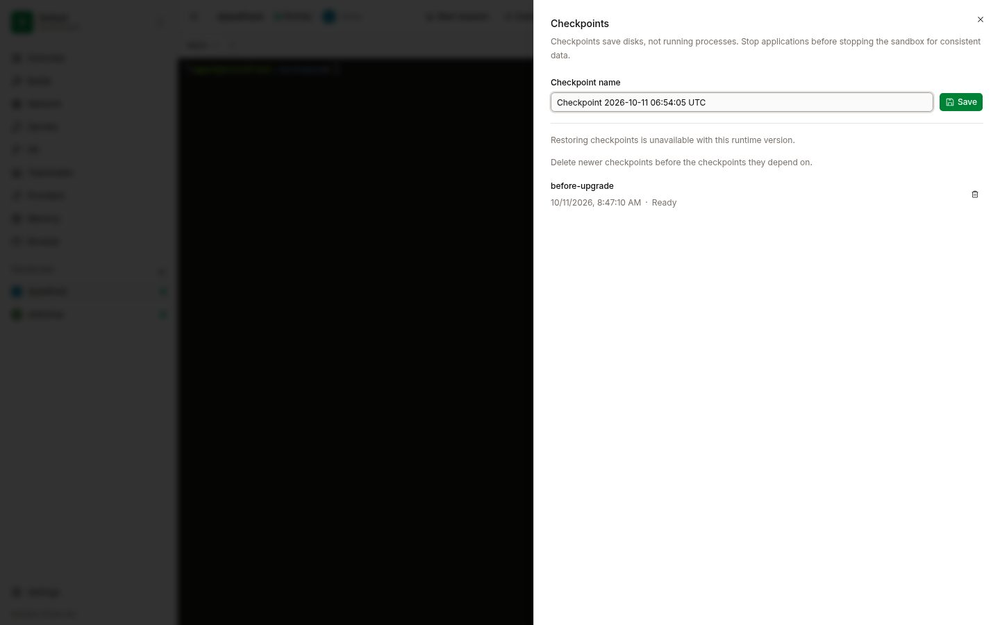

A checkpoint is a snapshot of a sandbox's disks: its root filesystem, `/workspace`, and Docker data. It does not save running processes or terminal sessions.

You can save a checkpoint while a sandbox is running or stopped. If it is running, the snapshot is crash-consistent: files being written may be incomplete. For application-level consistency, stop the application and sandbox before saving.

## Save and delete

Open **Checkpoints** from the sandbox toolbar, enter a name, and select **Save**. Studio records checkpoints in order; a later checkpoint can depend on an earlier one. Delete newer checkpoints before their parents.

Deleting a checkpoint removes only that snapshot. It does not change the sandbox.

## Restore is currently unavailable

Checkpoint restore is gated in the current runtime, and Studio disables the Restore control. You can save and delete checkpoints, but you cannot use them to roll a sandbox back yet.

For a portable copy of project files, use [Export](../sandboxes/#export-a-workspace). Export includes `/workspace`, not the full disks or Docker data.
