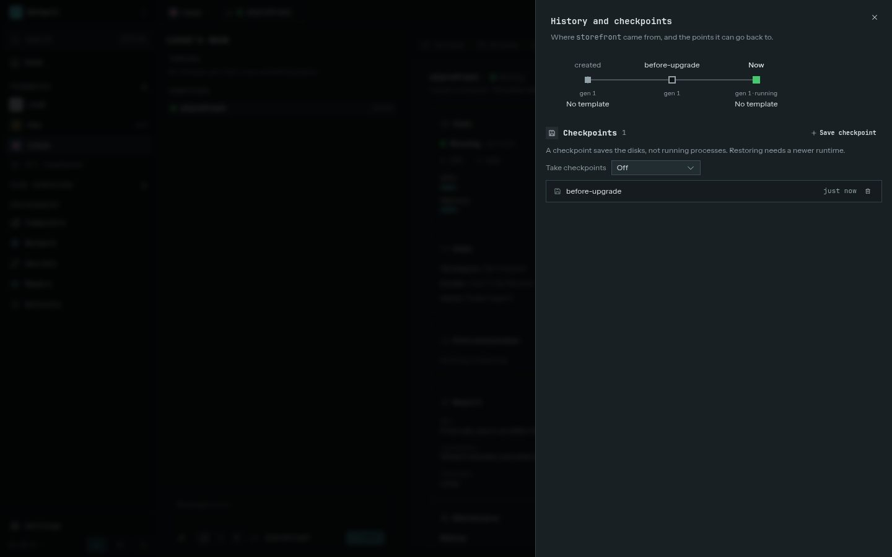

A checkpoint is a snapshot of a computer's disks: its root filesystem, `/workspace`, its home directory, and Docker data. It does not save running processes or terminal sessions.

You can save a checkpoint while a computer is running or stopped. A running computer is frozen while its filesystems are flushed, so the snapshot is consistent for the filesystem but not for programs: a file a program was halfway through writing may be incomplete. For a consistent copy of an application's data, stop the application, or the computer, before saving.

Two kinds of computer must be stopped, or restarted, first:

- A computer created with systemd as its init can only be checkpointed while it is stopped.
- A computer still running as microsandbox started it before a Studio upgrade says to restart it; after that, checkpoints and forks work again.

## Save and delete

On the computer's **Details** tab, the **Checkpoints** card lists the latest three, and **All checkpoints and history…** opens the rest, in *History and checkpoints*. To save one, choose **Checkpoint now** on that card or in the **⋯** menu, or **Save checkpoint** in the history, enter a name and select **Save**. A computer that is off shows its last checkpoint on its screen.

From a terminal, `studio checkpoints <computer>` lists them and `studio checkpoint <computer> [name]` saves one (see [CLI](../cli/)). In the [terminal UI](../tui/), `h` opens a computer's checkpoints and `n` saves one.

Deleting a checkpoint removes only that snapshot, in any order. It does not change the computer.

Each checkpoint holds a full copy of the computer's disks, so it takes about as much disk space as the computer uses.

## Take checkpoints on a schedule

Under **Take checkpoints**, choose **Every hour**, **Every 4 hours**, **Every 12 hours** or **Daily**. It is **Off** by default. Studio takes the first checkpoint right away, then one each interval while the computer runs. A stopped computer gets one only if it ran since the last, and a suspended one waits until it resumes.

Choose **After every task** instead to take one each time an agent finishes a message that changed files, in any chat on the computer. A message that only answered a question takes none, and neither does work in a terminal. If the computer is busy with another operation, the checkpoint follows a minute later.

Scheduled checkpoints are named after the time they were taken and marked **auto**. Studio keeps the newest three and the last of each day for a week, and deletes older ones it took, so a computer has at most ten. It never deletes the checkpoints you saved. To keep a scheduled checkpoint, rename it on the **History** line; it is then yours.

If a scheduled checkpoint can't be taken, the section says why, starting *The last one wasn't taken*, and Studio tries again 15 minutes later. Turning the schedule **Off** keeps the checkpoints it took.

## Rename

Select a checkpoint on the computer's history line and choose **Rename**. Renaming changes only the label, and makes a scheduled checkpoint yours. The saved disks stay as they are.

## Restore is currently unavailable

Restoring a checkpoint waits on a fix in microsandbox ([#1736](https://github.com/superradcompany/microsandbox/issues/1736)): the current version can't keep a restored computer's network routed through Studio. Until then the history shows **Restore** and **Fork from here** greyed out, and `studio restore` refuses. You can save, rename and delete checkpoints, but not roll a computer back.

For a portable copy of project files, use [Export](../sandboxes/#export-a-workspace). Export includes `/workspace` and the home directory, not the root filesystem or Docker data.
