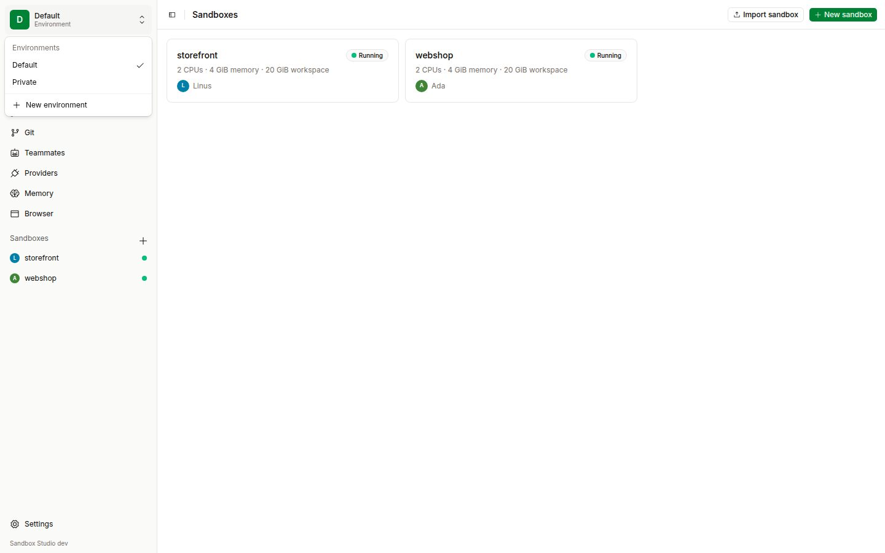

An environment is a separate workspace inside Studio. Use the switcher at the top of the sidebar to move between environments or create another one.

Each environment has its own:

- sandboxes and templates;
- network rules and approval inbox;
- secrets and AI providers;
- teammates, Git forges, and memory.

For example, keep work credentials and network rules in a **Work** environment and personal projects in **Private**. A sandbox belongs to one environment, and an agent can use only that environment's providers, secrets, rules, and memory.

## Scoping a rule

Network rules can apply to every sandbox in an environment, one teammate's sandboxes, or one sandbox. A teammate rule follows the teammate's ownership; it does not grant access to another teammate's sandboxes. An environment-level deny acts as a fence and takes precedence over narrower allows.

See [Network rules](../network/) for rule actions and [Teammates and providers](../teammates-providers/) for sandbox ownership.
