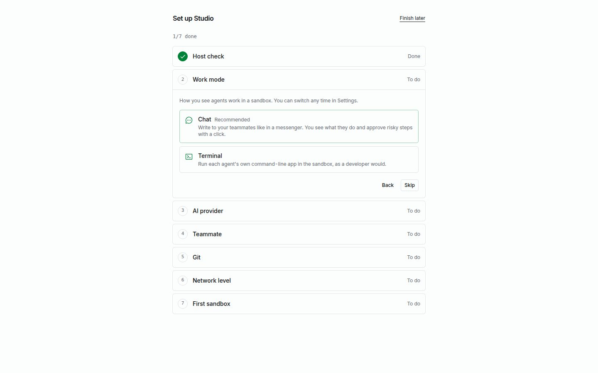
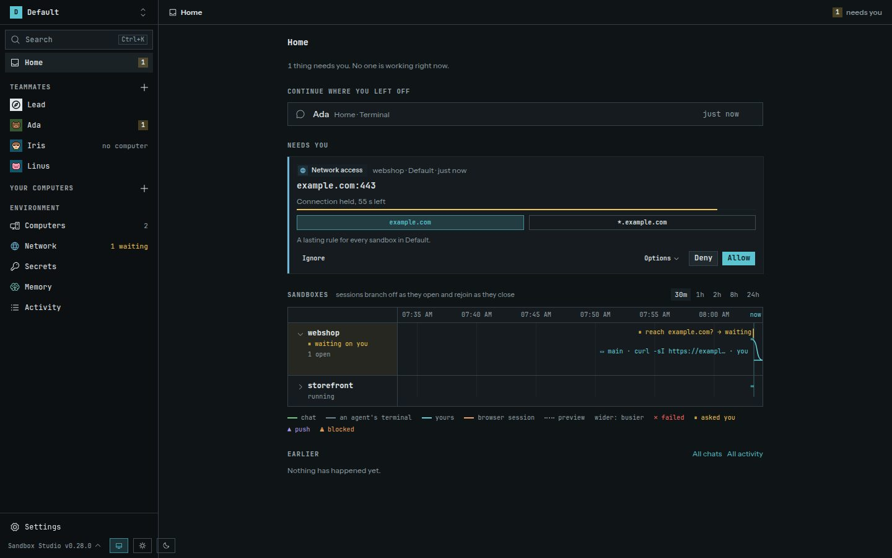
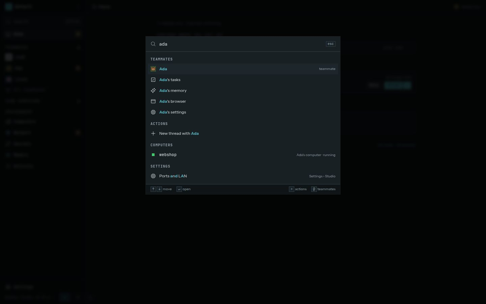

## Before you install

Studio runs local microVMs, so the host needs hardware virtualization:

- **Linux:** amd64 or arm64, with readable and writable access to `/dev/kvm`.
- **macOS:** Apple Silicon. Intel Macs are not supported.
- **Windows:** Windows 11 on amd64 with Windows Hypervisor Platform enabled. Windows support is a preview.

Keep at least 5 GB free for the runtime, images, and sandbox disks. On first start Studio downloads the matching microsandbox runtime; it pulls the base image when the first sandbox needs it. The host needs internet access for these downloads.

## Install

On Linux and macOS, run the installer:

```sh
curl -fsSL https://raw.githubusercontent.com/lukaskoebe/sandbox-studio/main/install.sh | sh
```

The script downloads the latest release for your platform, checks it against the release's `checksums.txt` (and its build provenance, when the GitHub CLI `gh` is installed and signed in), and installs `studio` to `~/.local/bin` without sudo. If that directory is not on your `PATH`, it prints the line to add to your shell profile. It then checks KVM or Hypervisor.framework access and tells you what to fix; it never installs other software. Set `SANDBOX_STUDIO_VERSION` (for example `v0.3.4`) to pick a release and `SANDBOX_STUDIO_INSTALL_DIR` to change the directory.

On Windows, or to install by hand, download the archive for your platform from [GitHub Releases](https://github.com/lukaskoebe/sandbox-studio/releases) and verify it against `checksums.txt`. Each archive contains the `studio` executable (`studio.exe` on Windows); put it anywhere on your `PATH`. Next to it is `studio-app`, the [Studio app](#studio-in-a-window-of-its-own) (on macOS `Sandbox Studio.app`), and in the Windows archive also `studiow.exe`, the tray launcher; keep them in the same folder as `studio`.

### Build from source

From a terminal with Go 1.26, Node 22 with pnpm 11, a C toolchain, and Docker installed, run:

```sh
git clone https://github.com/lukaskoebe/sandbox-studio.git
cd sandbox-studio
make web
make build
make image
make image-browser
```

`make image` builds the local base image needed for new sandboxes. `make image-browser` builds the separate image for teammates' browsers; both development images must be loaded locally. The binary is `./bin/studio`.

## Start Studio

Open a terminal and check the host:

```sh
studio doctor
```

Then start the app:

```sh
studio
```

Studio opens in the [Studio app](#studio-in-a-window-of-its-own) when it is installed next to `studio`, and otherwise in your browser at `http://127.0.0.1:7878`. It prints a one-time link too: open that link in a browser on the same machine. It expires after ten minutes and can be used once. If you need another link while Studio is running, run `studio login-url`, or start `studio` again: a second start opens the running Studio. To only print the link, start it with `studio -no-browser`.

On Windows, double-click `studio.exe` or `studiow.exe`: either runs Studio in the background, without a console window, and opens it in the Studio app, whose icon in the notification area has the menu. Without the app, `studiow.exe` opens Studio in your browser and puts an icon of its own in the notification area: click it to open Studio, or right-click it for **Logs**, **Start at login** and **Quit**. **Quit** stops Studio; your computers keep running. With `studiow.exe` next to `studio.exe`, **Start at login** in Settings starts the tray too, and its icon opens the app when there is one. `studio.exe` started from a terminal runs in that terminal, as on Linux and macOS.

This is the sign-in for your local Studio app. It does not sign an agent into an AI provider. For agent sessions, add a provider in the environment first: an API key, or a Claude Pro/Max or ChatGPT subscription sign-in.

Studio listens on loopback, so other machines on your network cannot open its UI. The UI and the computers' services stay on the machine running Studio.

Studio is square by default, with titles, buttons and labels in mono. For a soft, rounded look in sans, set **Style** to **Quiet** under **Settings → General**. Each browser keeps its own style, as it does light or dark, which you pick at the bottom of the sidebar.

To stop Studio, run `studio quit` or use **Shut down** under **Settings → General**; computers keep running. `studio restart` stops Studio and starts it again. Installing a new version restarts a running Studio by itself. To remove Studio and everything it created, run `studio uninstall`, which lists what goes and asks you to confirm.

To start Studio when you log in, turn on **Start at login** under **Settings → General**, or run `studio autostart enable`. It is off by default.

Studio checks GitHub for a newer release once a day. **Settings → Updates** shows it, and **Settings** in the sidebar says **Update available**. **Check for updates** looks right away, and **Update now** installs the release. Set **Updates** to **Off** to stop the check, or to **Install automatically** to have Studio install releases itself: it downloads the release, verifies it against `checksums.txt` and its GitHub build attestation, and restarts into it once no chat, template build or sign-in is running. If the new version doesn't start, the old one and its database come back. Studio can install itself only where it may write to the folder its binary is in, as with `install.sh`.

On a first start, Studio opens a guided setup at `/setup`. It checks the host, adds an AI provider, accepts a default teammate, connects a git forge if you have one, picks a network security level, and creates a first computer. Each step can be skipped. Until the setup is complete or dismissed, Home shows a card with the steps still open, and you can resume the setup from there. After it, Home shows **Get to know Studio**: a first task to give a teammate, and five features that tick off as you use them. The first time each one happens, a tip beside it explains it; **Stop tips** closes them all, and **Settings → General → Tips** shows them again.



### Studio in a window of its own

```sh
studio app
```

`studio app` opens Studio in a window of its own, with an icon in the tray or menu bar and the system's notifications. On Linux it is also in the desktop's launcher. It starts Studio in the background if it isn't running, and leaves it running when you close the app, so the browser keeps working beside it. The tray menu has **Open Studio**, **Open in browser**, **Close the app** and **Quit Studio**, which stops Studio too; your computers keep running. Links to other sites, sign-ins and previews open in your browser.

The window has no system title bar on Linux and macOS. On Linux a slim bar at the top of the page moves the window, and a double click maximises it; on macOS the window's buttons sit over the top of the sidebar. Set `SANDBOX_STUDIO_TITLEBAR=system` to bring the system's title bar back. `studio uninstall` also removes the launcher entry.

On Linux the app needs GTK 3 and WebKitGTK 4.1 (`libwebkit2gtk-4.1-0` on Debian and Ubuntu, `webkit2gtk4.1` on Fedora). Without them, or without a display, `studio app` opens Studio in your browser instead and says why. On NixOS the prebuilt app finds its libraries through [nix-ld](https://github.com/nix-community/nix-ld): enable `programs.nix-ld` with `programs.nix-ld.libraries = [ pkgs.gtk3 pkgs.webkitgtk_4_1 pkgs.libsoup_3 pkgs.glib pkgs.gdk-pixbuf pkgs.xorg.libX11 ]`. The install script puts `studio-app` next to `studio`.

Or install Studio as a web app: in Chrome or Edge, choose **Install Sandbox Studio** in the address bar or the browser menu; in Safari, choose **File → Add to Dock**. The web app shows the number of approvals waiting on its icon. It belongs to the address you installed it from, so keep Studio on the same port.

## Find your way around



**Home** shows what needs you, such as a network request or a push to review, and below it a timeline of each computer: its chats, terminals, browser sessions and previews branch off its line as they open and rejoin it as they close. **Earlier** lists what happened before. The sidebar lists, from the top:

- the environment you are in, which switches to [another](../environments/);
- **Search** (⌘K or Ctrl+K), which finds teammates, computers, threads, settings and actions;
- **Teammates**, each with its threads, a terminal button and **+** for a new thread;
- **Your computers**, the [computers](../sandboxes/) without a teammate;
- **Environment**: **Computers**, [**Network**](../network/), [**Secrets**](../secrets/), [**Memory**](../memory/) and **Activity**, which lists what was decided and what happened;
- **Settings**, the version, and the theme.



The bar at the top names where you are; each part of it opens a menu that switches teammate, computer or settings section. Alt+← and Alt+→ go back and forward through Studio's pages, and so do ⌘[ and ⌘] on a Mac.

## Prepare your first agent

The guided setup adds the provider, creates a default teammate named Iris for it, and gives Iris the first computer. To do the same by hand:

1. In **Settings → AI providers**, sign in with a Claude Pro/Max or ChatGPT subscription, or add an Anthropic API key, an OpenAI API key, or a supported OpenAI-compatible endpoint.
2. Choose **+** next to **Teammates** in the sidebar. Give the teammate a name and role, and pick its provider, harness and default model. Its optional working instructions (“soul”) can come later.
3. Open the teammate and choose **Give Iris a computer**, or pick the teammate in **New computer**. You can change a computer's teammate later, while it is stopped, on its **Details** tab.
4. Write to the teammate in the box on its home. Each message starts a thread, which runs the agent on the computer named under the box. To work beside it, open a **New shell** (**+** in the terminal's tabs) and start the agent there yourself, or press `T` in the [terminal UI](../tui/).

See [Teammates and providers](../teammates-providers/) for supported combinations, and [Network rules](../network/) for how the first outbound request is handled.

## Where Studio stores data

The default data directory is:

| Host | Location |
| --- | --- |
| Linux | `~/.local/share/sandbox-studio` |
| macOS | `~/Library/Application Support/Sandbox Studio` |
| Windows | `%LOCALAPPDATA%\Sandbox Studio` |

This directory holds the catalog and local Studio data. On Windows, Studio's log is in its `logs` folder, and the console window shows only warnings and errors. Set `SANDBOX_STUDIO_HOME` before starting Studio to use another location. The encrypted vault's master key is kept in the OS keychain where available; on systems without one, Studio uses an owner-only file.

## Host-specific help

- On Linux at a desktop session, systemd-logind usually grants `/dev/kvm` access. Over SSH or on a headless host, you may need to add your user to the `kvm` group and sign in again. Inside a VM, nested virtualization must be enabled.
- On Windows, enable **Windows Hypervisor Platform** and reboot. Windows is still a preview.
- If a check fails, `studio doctor` and **Settings → Runtime** show the finding and a suggested fix. See [Troubleshooting](../troubleshooting/).
