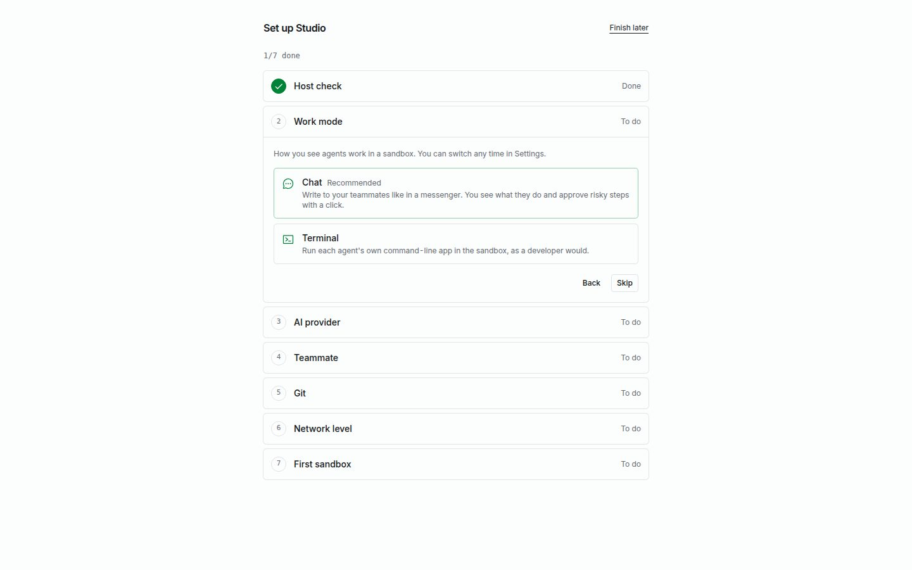

## Before you install

Studio runs local microVMs, so the host needs hardware virtualization:

- **Linux:** amd64 or arm64, with readable and writable access to `/dev/kvm`.
- **macOS:** Apple Silicon. Intel Macs are not supported.
- **Windows:** Windows 11 on amd64 with Windows Hypervisor Platform enabled. Windows support is a preview.

Keep at least 5 GB free for the runtime, images, and sandbox disks. On first start Studio downloads the matching microsandbox runtime; it pulls the base image when the first sandbox needs it. The host needs internet access for these downloads.

## Install

On Linux and macOS, run the installer:

```sh
curl -fsSL https://raw.githubusercontent.com/lukaskoebe/sandbox-studio/main/install.sh | sh
```

The script downloads the latest release for your platform, checks it against the release's `checksums.txt` (and its build provenance, when the GitHub CLI `gh` is installed and signed in), and installs `studio` to `~/.local/bin` without sudo. If that directory is not on your `PATH`, it prints the line to add to your shell profile. It then checks KVM or Hypervisor.framework access and tells you what to fix; it never installs other software. Set `SANDBOX_STUDIO_VERSION` (for example `v0.3.4`) to pick a release and `SANDBOX_STUDIO_INSTALL_DIR` to change the directory.

On Windows, or to install by hand, download the archive for your platform from [GitHub Releases](https://github.com/lukaskoebe/sandbox-studio/releases) and verify it against `checksums.txt`. Each archive contains the `studio` executable (`studio.exe` on Windows); put it anywhere on your `PATH`. The Windows archive also has `studiow.exe`, the tray launcher; keep it in the same folder as `studio.exe`.

### Build from source

From a terminal with Go 1.26, Node 22 with pnpm 11, a C toolchain, and Docker installed, run:

```sh
git clone https://github.com/lukaskoebe/sandbox-studio.git
cd sandbox-studio
make web
make build
make image
make image-browser
```

`make image` builds the local base image needed for new sandboxes. `make image-browser` builds the separate image for teammates' browsers; both development images must be loaded locally. The binary is `./bin/studio`.

## Start Studio

Open a terminal and check the host:

```sh
studio doctor
```

Then start the app:

```sh
studio
```

Studio opens its local UI at `http://127.0.0.1:7878` in your browser, and prints a one-time link to it too. Open that link on the same machine. It expires after ten minutes and can be used once. If you need another link while Studio is running, run `studio login-url`, or start `studio` again: a second start opens the running Studio. To only print the link, start it with `studio -no-browser`.

On Windows, double-click `studiow.exe` instead to run Studio without a console window. It starts `studio.exe` in the background, opens Studio in your browser and puts an icon in the notification area: click it to open Studio, or right-click it for **Logs**, **Start at login** and **Quit**. **Quit** stops Studio; your sandboxes keep running. With `studiow.exe` next to `studio.exe`, **Start at login** in Settings starts the tray too.

This is the sign-in for your local Studio app. It does not sign an agent into an AI provider. For agent sessions, add a provider in the environment first: an API key, or a Claude Pro/Max or ChatGPT subscription sign-in.

Studio listens on loopback, so other computers on your network cannot open its UI. The UI and the sandbox services stay on the machine running Studio.

To give Studio a window and a dock or taskbar icon of its own, install it as an app: in Chrome or Edge, choose **Install Sandbox Studio** in the address bar or the browser menu; in Safari, choose **File → Add to Dock**. The app shows the number of approvals waiting on its icon. It belongs to the address you installed it from, so keep Studio on the same port.

Studio is square by default, with titles, buttons and labels in mono. For a soft, rounded look in sans, set **Style** to **Quiet** under **Settings → General**. Each browser keeps its own style, as it does light or dark, which you pick at the bottom of the sidebar.

To start Studio when you log in, turn on **Start at login** under **Settings → General**, or run `studio autostart enable`. It is off by default.

Studio checks GitHub for a newer release once a day and shows it under **Settings → General → Updates** and in the sidebar. Set **Updates** to **Off** to stop the check, or to **Install automatically** to have Studio install releases itself: it downloads the release, verifies it against `checksums.txt` and its GitHub build attestation, and restarts into it once no chat, template build or sign-in is running. If the new version doesn't start, the old one and its database come back. Studio can install itself only where it may write to the folder its binary is in, as with `install.sh`.

On a first start, Studio opens a guided setup at `/setup`. It checks the host, adds an AI provider, accepts a default teammate, connects a git forge if you have one, picks a network security level, and creates a first sandbox. Each step can be skipped. Until the setup is complete or dismissed, Home shows a card with the steps still open, and you can resume the setup from there.



## Prepare your first agent

The guided setup adds the provider, creates a default teammate named Iris for it, and creates the first sandbox with Iris. To do the same by hand:

1. In **Settings → AI providers**, sign in with a Claude Pro/Max or ChatGPT subscription, or add an Anthropic API key, an OpenAI API key, or a supported OpenAI-compatible endpoint.
2. In Teammates, create a teammate and choose its harness, provider, model, role, and optional working instructions (“soul”).
3. Create a sandbox and select that teammate. Ownership is fixed when the sandbox is created.
4. Open the sandbox and select **Start session**. The agent opens in a terminal tab.

See [Teammates and providers](../teammates-providers/) for supported combinations, and [Network rules](../network/) for how the first outbound request is handled.

## Where Studio stores data

The default data directory is:

| Host | Location |
| --- | --- |
| Linux | `~/.local/share/sandbox-studio` |
| macOS | `~/Library/Application Support/Sandbox Studio` |
| Windows | `%LOCALAPPDATA%\Sandbox Studio` |

This directory holds the catalog and local Studio data. On Windows, Studio's log is in its `logs` folder, and the console window shows only warnings and errors. Set `SANDBOX_STUDIO_HOME` before starting Studio to use another location. The encrypted vault's master key is kept in the OS keychain where available; on systems without one, Studio uses an owner-only file.

## Host-specific help

- On Linux at a desktop session, systemd-logind usually grants `/dev/kvm` access. Over SSH or on a headless host, you may need to add your user to the `kvm` group and sign in again. Inside a VM, nested virtualization must be enabled.
- On Windows, enable **Windows Hypervisor Platform** and reboot. Windows is still a preview.
- If a check fails, `studio doctor` and **Settings → Runtime** show the finding and a suggested fix. See [Troubleshooting](../troubleshooting/).
