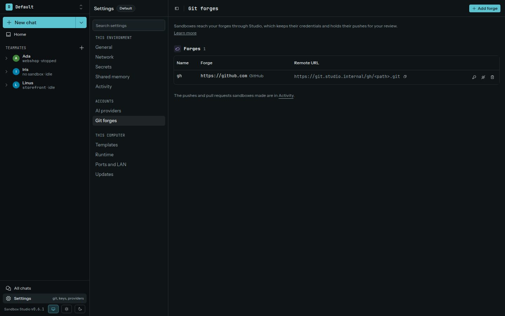

For a forge added on an environment's **Git** page, Studio can act as the virtual Git remote. When a sandbox pushes through Studio, the change is staged in a private per-sandbox repository and appears in the approval inbox as a diff. The upstream branch does not change until you approve the push.

## Add a forge

Studio supports GitHub, Forgejo/Gitea/Codeberg, other HTTPS Git hosts, and SSH Git hosts. Add each forge to the environment where its sandboxes will use it. Forge hosts must be public; private and LAN hosts are refused. Paste a repository URL, such as `git@github.com:owner/repo.git`, and Studio fills in the rest of the form.

- For GitHub or Forgejo/Gitea/Codeberg, add a token with access limited to the repositories the agent needs.
- For another HTTPS host, provide its username and token.
- For SSH, Studio signs with the keys in your SSH agent, the same ones `ssh` uses. Compare the scanned host-key fingerprint with the fingerprint published by the host, then confirm it. To keep a key for Studio alone, choose a Studio key instead: Studio creates it and shows its public key for you to add to the host.

Forge tokens and Studio's SSH keys stay in Studio's host-side vault. Your SSH agent is only used on the host. Neither reaches a sandbox. **Settings → Git** can test a forge connection and replace an expiring token.

The forge row shows its Studio remote URL, in the form `https://git.studio.internal/<forge>/<path>.git`. Copy that URL when cloning from a plain terminal. When an agent session starts, Studio also writes managed Git URL rules so common URLs for configured forges can route through Studio.

## Push and review

When a sandbox pushes through a configured forge, Studio stages the push and asks for review. The approval shows the sandbox, branch, commits, and a bounded diff. You can approve, reject, or ignore it. Studio checks that the upstream branch has not changed unexpectedly before it pushes the approved commit.

GitHub and Forgejo/Gitea forges can also request approval to open a pull request after a reviewed push to a non-default branch. Other HTTPS and SSH forges do not provide pull-request proposals.

If a host is not configured as a forge, access follows normal network rules and is not staged for Git review. Do not assume every arbitrary Git remote receives review protection.

See the [Git review guide](https://github.com/lukaskoebe/sandbox-studio/blob/main/docs/git-review.md) for supported forge details and the SSH host-key flow.
