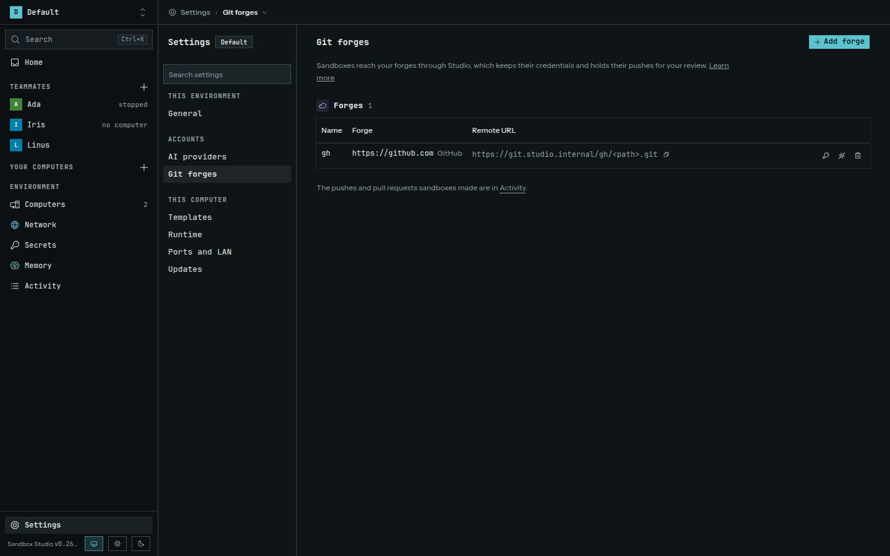

For a forge added in **Settings → Git forges**, Studio can act as the virtual Git remote. When a computer pushes through Studio, the change is staged in a private per-computer repository and waits for your review. The upstream branch does not change until you approve the push.

Pushes and pull requests waiting for you are on **Home** under **Needs you**, in a card at the bottom right of Studio's other pages, and under **Waiting for you** in the computer's **Changes** tab, where each one opens its review. The **Activity** page, under **Environment** in the sidebar, lists the decided ones; its **Git** filter shows only them.

## Add a forge

Studio supports GitHub, GitLab, Forgejo/Gitea/Codeberg, other HTTPS Git hosts, SSH Git hosts, and folders of repositories on this computer. Add each forge to the environment whose computers will use it. Forge hosts must be public; private and LAN hosts are refused. Paste a repository URL, such as `git@github.com:owner/repo.git`, and Studio fills in the rest of the form: an SSH URL keeps its user, here `git`. The SSH address of an **Other SSH** forge takes a clone URL too.

- For GitHub, GitLab or Forgejo/Gitea/Codeberg, add a token with access limited to the repositories the agent needs. A GitLab token needs the **api** and **write_repository** scopes.
- For another HTTPS host, provide its username and token.
- For a folder on this computer, paste a repository's path, such as `~/git/app`: Studio makes a **Folder on this computer** forge for the folder it is in, with no token. Computers can fetch every repository in the folder; an approved push goes in with your git, as `git push` to the folder would, so the repository's hooks run. A push to the branch the working copy has checked out says so on its card, with **Update the checked-out files too** ticked: approved, the working copy's files follow the branch, unless it has changes of its own, which git refuses rather than overwrite.
- For SSH, Studio signs with the keys in your SSH agent, the same ones `ssh` uses. Compare the scanned host-key fingerprint with the fingerprint published by the host, then confirm it. For GitHub, GitLab and Bitbucket, Studio already knows the keys they publish: their scan shows "The key GitHub publishes" (or GitLab, or Bitbucket) with nothing to compare, and any other key is refused. To keep a key for Studio alone, choose a Studio key instead: Studio creates it and shows its public key for you to add to the host.
- For pull requests on an SSH forge, pick its API under **Pull requests** (Forgejo or Gitea, GitHub, or GitLab) and add a token, when adding the forge or later with **Add an API token** in its row. Git still goes over SSH; the API lists the forge's repositories and serves pull requests, so agents use one forge for both. For `github.com`, `gitlab.com` and `codeberg.org`, Studio fills in the API.

Forge tokens and Studio's SSH keys stay in Studio's host-side vault. Your SSH agent is only used on the host. Neither reaches a computer. If your agent asks you to confirm each signature, as hardware keys and password managers do, Studio's own fetch before a push runs at most once every 30 seconds per computer and repository, so a burst of pushes asks once. **Settings → Git forges** can test a forge connection and replace an expiring token.

The forge row shows its Studio remote URL, in the form `https://git.studio.internal/<forge>/<path>.git`. Copy that URL when cloning from a plain terminal. When an agent session starts, Studio also writes managed Git URL rules so common URLs for configured forges can route through Studio.

When git on a computer wants credentials for an HTTPS host no forge covers, such as a private repository on `github.com` before you added GitHub, Home shows a card: "<teammate> needs access to github.com". **Add forge** opens the Add forge dialog filled in from the repository's URL; the agent's next try goes through Studio. **Not now** keeps Studio from asking about that host for a day. The agent reads in git's output that you have the card, and git still fails until the forge exists: computers never hold a credential.

When git on a computer connects over SSH to a forge's host, such as `git@github.com:owner/repo.git`, the network card for port 22 says so. Computers hold no SSH key, so the card points to the repository's `https://` URL instead, which goes through Studio with the forge's credential, and offers **Add forge** when Studio has none for the host.

## Push and review

When a computer pushes through a configured forge, Studio stages the push and asks for review. The review opens in the computer's **Changes** tab, where the branch and its change scroll away above the diff. The **All commits** menu above it narrows the diff to one commit of the push, with its message; line comments go on the whole push, so **all its commits** brings it back to comment. **Approve and push** and **Reject** stay at the bottom while you read; when the push can open a pull request, **Also open a pull request into** its base branch is offered, with a title, and the button becomes **Push and open pull request**. The **⋯** beside them has **Send without deciding**, **Leave without deciding**, which keeps the note and comments for the agent to read, and **Ignore**, which closes the review without an answer to the agent. Studio checks that the upstream branch has not changed unexpectedly before it pushes the approved commit.

The diff shows old and new lines in one column or side by side; **Stacked** and **Split** above it switch, and the list of files beside it, or above the first file on a narrow screen, jumps to a file. Tick **Viewed** on a file, in its header or in the list, to fold it away; the bar counts how many you've viewed, and **Next unviewed** goes to the next one. The marks belong to the branch, so when the agent pushes it again after a rejection, the files you viewed stay viewed, unless they changed since: those say **Changed since you viewed it** and count again. A review keeps your place: another tab, another computer, a folded screen or closing and reopening Studio brings you back to the file and line you were reading, with your note and line comments, until you decide. They are kept in this browser or app only. If an approved push didn't go upstream, the review says why and keeps the commit staged: once the cause is fixed, for example the forge's token, choose **Push again**. Pushed branches stay under **Pushed** in the Changes tab for a day, with their pull request's state, checks and comments.

An agent that rebases a branch and pushes it with `--force-with-lease` rewrites its history. The review then says **rewrites history**, lists the commits the push drops from the forge, each with the new commit that replaces it where the rebase kept it, and names the files in which the old and the new tip differ; the diff shows the rewritten commits on the branch they now build on. Only **Force-push** approves it. Studio pushes with a lease on the commit you reviewed, so commits that reached the forge in the meantime are never dropped. The repository's default branch takes no rewrites.

To tell the agent what to change, comment on lines of the diff with the button that appears when you point at a line's number, or by clicking or tapping the number; drag over several numbers, or shift-click, to comment on a range. The bar above the diff counts your comments: a click lists them and takes you to one, and its arrows go to the previous and the next. Below the diff, beside the decision, **Add a note** opens a note for the agent, and the line next to it says how many comments and whether a note go with your decision. A rejection and its note reach the agent the next time it fetches or gets a prompt. That next `git fetch` or `git pull` of the repository fails once with the reason and the next one works, so a script that updates repositories on its own should try again: `git fetch || git fetch`. To tell it right away, choose one of the computer's chats or agent terminals under **Send to** before you decide, including an agent you started by hand in a terminal, or **A new chat**: Studio sends the outcome, your note and your line comments there. A chat that is working gets them when its current turn ends. **Send without deciding** sends them and keeps the push waiting, so the agent can push a fix that replaces it. Plain shell terminals are not offered, since text typed into them would run as commands.

With a keyboard, a review takes keys while you aren't typing: **j** and **k** go to the next and previous file, **n** and **p** to the next and previous comment, **v** marks the file you're reading viewed and goes to the next one you haven't, **c** comments on the line in focus (the comment or file you last went to, or else the first changed line on screen), and **?** lists them. The line under the decision names them too.

GitHub, GitLab and Forgejo/Gitea forges can also request approval to open a pull request (a merge request on GitLab) after a reviewed push to a non-default branch. Other HTTPS, SSH and local forges do not provide pull-request proposals. An agent can also propose one itself, with its own title and description, for a branch it pushed (`studio pr create`): you approve it on the same card. A comment it wants to post on a pull request's conversation (`studio pr comment`) waits for you the same way; you can edit it, and it posts as your forge account.

## Pull request reviews

An agent can review any pull request on a GitHub, GitLab or Forgejo/Gitea/Codeberg forge, yours or anyone else's, in the repositories the forge's token reaches. It can list those repositories and their open pull requests itself, so "review the open pull requests in acme/web" is enough. It reads the pull request, the reviews and comments so far, and its code, then drafts a review with a verdict (**Comment**, **Approve** or **Request changes**), a summary and comments on lines of the diff. The draft waits on Home like a push, for example "Review acme/web#42: request changes, 3 comments". A comment on someone else's pull request is a review with the verdict **Comment**. Nothing reaches the forge until you post it.

The review shows the pull request with a link to it on the forge, the verdict, the summary and the diff with the draft's comments on their lines. You can change all of it: switch the verdict, rewrite the summary, edit or remove a comment, and add your own with a line's comment button. If the pull request moved since the agent read it, the review says so, such as "1 new commit since Ada read it". **Post review** posts it with the forge's token, so it appears as yours; the footer names the account and the host. A forge does not take a verdict from the pull request's author, so on a pull request you opened the review posts as a comment that starts with the verdict. Tick **End with “Review by Ada (agent)”** to say who wrote it; it is off by default and remembered per teammate in your browser.

**Discard…** drops the draft and tells the agent your note, at once in one of its chats or terminals if you pick one, and otherwise with its next prompt. Agents can also ask Studio what became of a draft.

If a host is not configured as a forge, access follows normal network rules and is not staged for Git review. Do not assume every arbitrary Git remote receives review protection.

## Pull requests on the computer

On a computer, `~/forge` holds the pull requests of its repositories as read-only files: `pulls.md` per repository with the open ones and those closed in the last week, and a folder per pull request of the computer's own branches, or one it read, with `pr.md`, `conversation.md`, `reviews.md`, `files.md` and, while it is open, `checks.md`. Studio writes it when a session starts, every 5 minutes while one runs, and on `studio forge sync`. A folder on this computer has no pull requests, so for a repository cloned from one Studio uses the forge where its pull requests are instead: one the computer's clone also has as a remote, or one the folder's repository pushes to, if that forge is set up in the environment. The `studio pr` commands do the same. Agents read and act on pull requests with `studio pr list`, `read`, `create`, `review`, `comment` and `checks`; `studio pr checks --wait` waits for the CI checks to finish. See [CLI](../cli/#inside-a-computer).

See the [Git review guide](https://github.com/lukaskoebe/sandbox-studio/blob/main/docs/git-review.md) for supported forge details and the SSH host-key flow.
