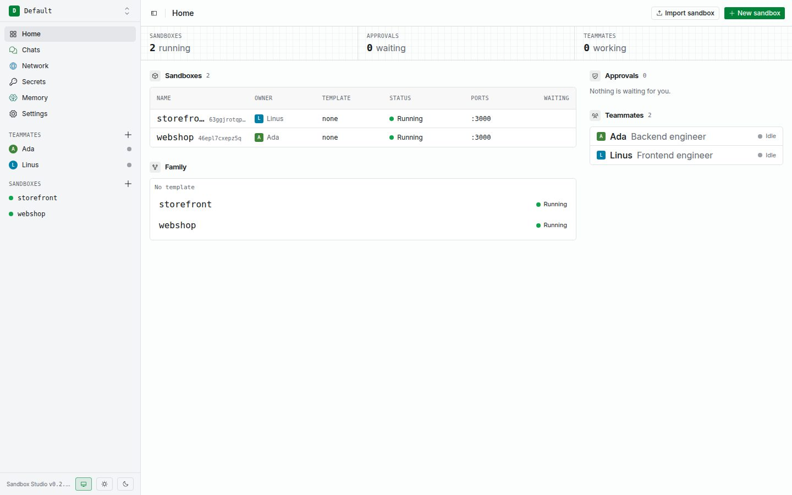

Sandbox Studio runs OpenCode, Claude Code, or Codex inside a microVM on your machine. Each sandbox keeps its workspace and Docker data between sessions. The Studio app stays on the host and handles network access, credentials, browser actions, and Git review.

## A useful boundary

- **Your files stay in a sandbox.** Each sandbox has its own persistent Linux workspace and terminal.
- **You control access out.** Network rules apply to sandbox traffic, including Docker containers. Unknown hosts wait for your decision.
- **Secrets stay on the host.** Sandboxes receive placeholders; Studio substitutes secret values only for approved, host-bound HTTPS traffic.
- **You review configured Git pushes.** Forges added under **Settings → Git** receive pushes only after you approve the staged change.

## Choose a guide

- [Install Studio and create your first teammate](./getting-started/)
- [Understand environments](./environments/)
- [Create sandboxes, use terminals, and open previews](./sandboxes/)
- [Set up network rules and approvals](./network/)
- [Keep API keys and other secrets out of sandboxes](./secrets/)
- [Connect a provider and configure teammates](./teammates-providers/)
- [Build a reusable sandbox template](./templates/)
- [Save disk checkpoints](./checkpoints/)
- [Use teammate and shared memory](./memory/)
- [Let an agent use an isolated browser](./browser/)
- [Review Git pushes](./git-review/)
