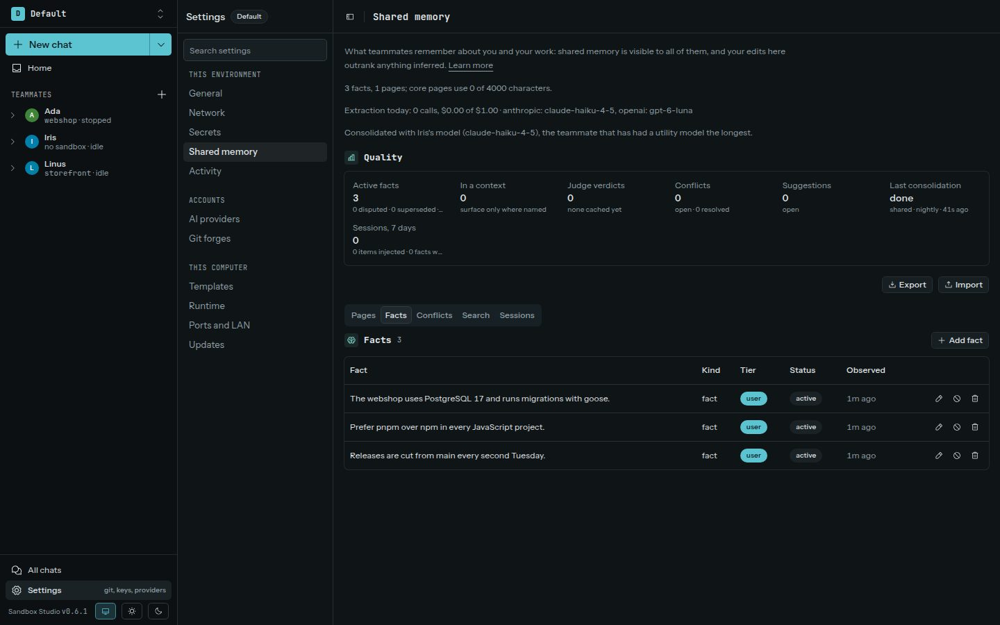

Memory is scoped to an environment. Each teammate has its own memory, and teammates in that environment can also use shared memory. A sandbox needs an owner teammate to use memory tools.

Studio can recall relevant notes when a supported agent session starts or when you send a prompt. After a session, Studio extracts lasting facts from the conversation and keeps a short summary of it, so the teammate's next session knows what it did last and in which sandbox. Chats are read a few minutes after their last turn; terminal sessions send their conversation through harness hooks. Memory capture is best-effort; it does not block the agent session.

## Review memory in Studio

Open **Settings → Shared memory** for shared memory, which every teammate sees. Each teammate also keeps private memory on its own page, under its **Memory** tab. Either one lets you inspect and edit pages and facts, search them, see conflicts, and review what the agent session recalled or proposed.

- Teammate facts and pages are visible in that teammate's scope.
- A teammate can propose a fact for shared memory. The proposal appears in the approval inbox; it becomes shared only after you approve it.
- If facts disagree, Studio records a conflict for you to resolve. Dismissing its inbox item does not resolve the conflict.
- A fact can hold only in a **Context**, such as one project. Search then finds it only for questions that name that context.
- **Suggestions** list what Studio's consolidation proposes but never applies on its own: **Promote** proposes a teammate fact that keeps coming back for shared memory, and **Accept** makes a page that sessions often need a core page. **Dismiss** drops a suggestion for good.
- **Settings → Shared memory** shows **Quality** numbers: facts by status, conflicts, open suggestions, and what the last week's sessions recalled and wrote.
- **Export** downloads a scope's pages and facts as one Markdown file, and **Import** reads such a file back into the same scope. Pages and facts the scope already has are skipped.

A teammate's conversation lists the facts it learned, each with **Forget**.

## Memory inside a sandbox

Each sandbox of a teammate has read-only Markdown copies of what the teammate's memory holds, in `~/memory`: `shared.md` for shared memory and `yours.md` for the teammate's own. Studio rewrites them shortly after memory changes while the sandbox is connected. The agent knows they are there, and you can read them from a terminal too. Facts that hold only in a context and text that looks like a credential are left out.

## What leaves the host

Embeddings are generated locally. When automatic extraction or consolidation runs, Studio sends selected conversation text or facts to the utility model for the configured provider, using the host-side API key. The memory budget is shared across the environment and capped at $1 per day for priced models, or 200 calls per day for models without a known price. Check the usage indicator on **Settings → Shared memory** to understand its model calls.

The real provider key is not sent to the guest or written in memory. Studio rejects extracted facts that contain credential-like values, but avoid including secrets in conversations in the first place.
