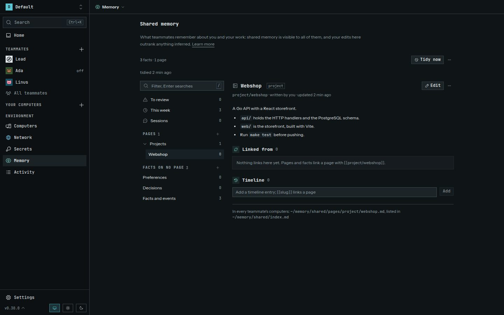

Memory is scoped to an environment. Each teammate has its own memory, and teammates in that environment can also use shared memory. A computer needs a teammate to use memory.

Studio can recall relevant notes when a supported agent session starts or when you send a prompt. After a session, Studio extracts lasting facts from the conversation and keeps a short summary of it, so the teammate's next session knows what it did last and on which computer. Chats are read a few minutes after their last turn; terminal sessions send their conversation through harness hooks. Memory capture is best-effort; it does not block the agent session.

## Review memory in Studio

Open **Memory** under **Environment** in the sidebar for shared memory, which every teammate sees. Each teammate also keeps private memory: in its settings, under **Knowledge → Memory**, choose **Open Iris's memory**, or search for *Iris's memory* with ⌘K. Both show an index on the left and what you pick in it on the right, and the address names what is open, so a link opens it again:

- **Needs you**: conflicts to resolve, suggestions to accept or dismiss, and loose ends: pages that are linked but don't exist yet, pages nothing links to, and topics with several facts but no page. **Create page** starts the missing page.
- **This week**: pages updated and facts learned.
- **Sessions**: what memory gave each agent session and what it learned.
- **Pages**, by kind, and **Facts on no page**, by kind. A pin marks a core page, which loads into every session. Click a page to open it; the **⋯** on a row edits, promotes, retracts or deletes, and a page's **⋯** makes it a core page or stops loading it everywhere.

Type in the search box (or press `/`) to filter the index; press Enter to search memory the way an agent does, with the reason for each hit. **Dream now** consolidates the memory right away; the **⋯** menu next to it has Export, Import, **Dream history**, **Extraction cost** and **How memory works**.

Under **Knowledge → Memory** in a teammate's settings, **Learn from its chats** turns extraction from its sessions on or off, and **Dream every night** tidies its memory after 3:00 and after 25 new facts. **Add a fact** and **Dream now** are there too, and **Teach** in the box on its home adds a fact without a thread.

- Teammate facts and pages are visible in that teammate's scope.
- A teammate can propose a fact for shared memory. The proposal waits on Home under **Needs you**; it becomes shared only after you approve it.
- If facts disagree, Studio records a conflict for you to resolve, on Home and with **Resolve…** under **Needs you**. Ignoring its card does not resolve the conflict.
- A fact can hold only in a **Context**, such as one project. Search then finds it only for questions that name that context.
- **Suggestions** list what Studio's consolidation proposes but never applies on its own: **Promote** proposes a teammate fact that keeps coming back for shared memory, and **Make core** makes a page that sessions often need a core page. **Dismiss** drops a suggestion for good.
- The **Memory** page shows **Quality** numbers: facts by status, conflicts, open suggestions, the last consolidation, and what the last week's sessions recalled and wrote.
- A page can link another with `[[slug]]`, such as `[[project/webshop]]` or `[[topic/deploys|the deploy steps]]`. An open page shows its links, the pages and facts that link to it (**Linked from**), and its timeline. A link to a page that doesn't exist yet reads "(no page yet)"; click it to create the page.
- **Export** downloads a scope's pages and facts as one Markdown file, and **Import** reads such a file back into the same scope. Pages and facts the scope already has are skipped.

A teammate's home shows what it learned between its threads, each with **Forget**.

## Memory inside a computer

Each computer of a teammate has a read-only folder of what the teammate's memory holds, in `~/memory`:

- `index.md` lists the teammate's pages, then the shared ones.
- `pages/<slug>.md` is one page, with its facts, its timeline and what links to it. Links between pages are ordinary relative links, so `grep -r`, `cat` and an editor follow them.
- `facts.md` holds the facts no page records.
- `shared/` has the same for shared memory.

Studio rewrites the folder shortly after memory changes while the computer is connected. The agent knows it is there, and you can read it from a terminal too. To search, remember or correct, an agent runs `studio memory search`, `get`, `page`, `remember`, `share`, `correct` and `forget` (see [CLI](../cli/#inside-a-computer)). Facts that hold only in a context and text that looks like a credential are left out.

Agents write pages too: a teammate keeps its own pages up to date, and its changes to a shared page, or to a page you wrote, wait for your approval on Home.

## What leaves the host

Embeddings are generated locally. When automatic extraction or consolidation runs, Studio sends selected conversation text or facts to the utility model for the configured provider, using the host-side API key. The memory budget is shared across the environment and capped at $1 per day for priced models, or 200 calls per day for models without a known price. Choose **Extraction cost** in the **⋯** menu on the **Memory** page to see today's calls and cost, and which model extracts.

The real provider key is not sent to the guest or written in memory. Studio rejects extracted facts that contain credential-like values, but avoid including secrets in conversations in the first place.
