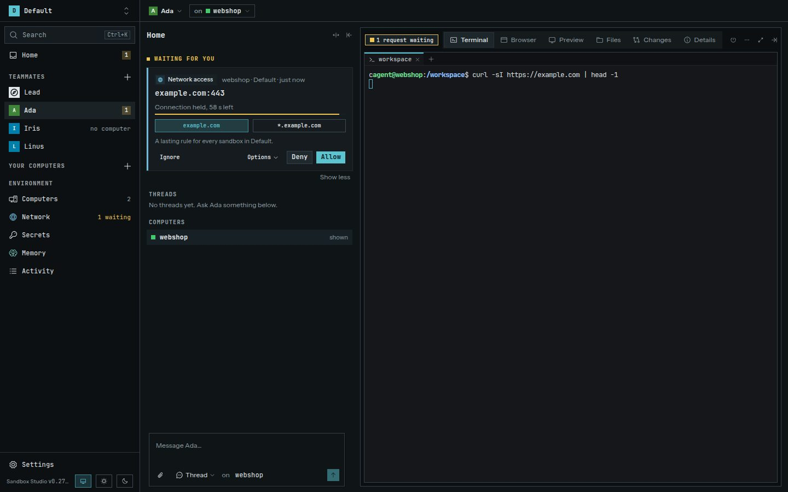
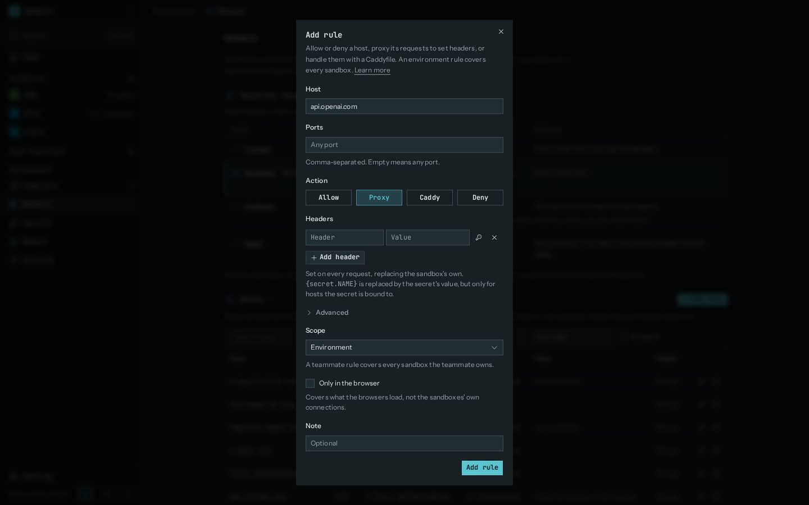

Every TCP connection of a computer (a sandbox) goes through Studio's gateway, including connections made by Docker containers inside it. DNS uses Studio's resolver (see [Names and lookups](#names-and-lookups)). UDP and ICMP are blocked. Outbound connections go to public addresses only, unless you open a port of [this computer](#this-computer) or list a host on the [local network](#local-network).

## Unknown hosts wait for you

When a sandbox reaches a host not covered by a rule, Studio holds the connection and asks you. The request waits on **Home** under **Needs you**, on the teammate's page under **Waiting for you**, and on Studio's other pages in the **needs you** list at the right of the top bar, whose rows have **Allow** and **Deny**. The computer's screen shows a count such as **2 requests waiting**, and **Network** in the sidebar says how many wait. The request includes the host, port, sandbox, and teammate if there is one.

**Allow** and **Deny** add a rule, so the next connection to the host doesn't ask. When the card offers several host patterns, such as `registry.npmjs.org` and `*.npmjs.org`, pick one first. **Options** on the card has two rows:

- **Who**: the whole **Environment**, the teammate's sandboxes, or only this sandbox. The teammate's **New rules from approvals apply to** setting picks the default. **Any port** makes the rule cover every port instead of the request's default ports.
- **For**: **Always**, **1 hour**, or **Once**, which answers this request, and other GET requests to the host that wait with it, and adds no rule; any other request asks again. **Once** is offered only while the connection is still held.

**Why? (saved on the rule)** keeps a note with the rule. **Ignore** refuses the request this time without a rule. Which scope the card preselects is set per teammate, under **Approvals** in its settings.

Studio holds the original connection for up to 60 seconds, and the card counts down, such as **Connection held, 42 s left**. If you allow it before the hold expires and the client is still waiting, Studio releases that same connection and the original operation continues. If the client gives up or the hold expires first, the connection closes, and the card says the client saw a failure: **Allow next time** makes the rule, so the client's next try goes through, and **Dismiss** drops the request.

To answer many at once, choose the count on the computer's screen: **Allow all** and **Deny all** make lasting rules for that sandbox, and **Review individually** opens them one by one. A browser page's requests arrive as one card, such as *example.com wants 4 hosts*, with the same three. In the sandbox's **Connections**, requests that gave up are kept under **Gave up waiting**, with **Dismiss all** and **Allow all next time**.

To hear of a held connection while Studio isn't in front, choose **Enable notifications** under **Settings → General → Notifications**. You can also answer in the [terminal UI](../tui/) or with `studio approve` and `studio deny` (see [CLI](../cli/)).



The **Network** page, under **Environment** in the sidebar, sets the security level, lists your rules, sorted by domain, with search and filters, then the curated list and the tracker list. The **Activity** page lists what was decided; its **Network** filter shows only connections. To see what one sandbox reached and what waits, open its computer's **Details** tab and choose **Show…** next to **Connections**.

## Names and lookups

A lookup leaves Studio only for a name the sandbox may already connect to: one a rule covers, or that its security level allows. Any other name gets an address of Studio's, and connecting to it asks you as usual; until the name is allowed, `dig` shows that address. So a lookup can't carry data out to a domain nobody allowed.

- TXT, MX and SRV lookups come back empty, and Connections says so. A tool that needs those records, such as `mongodb+srv://`, needs a rule for the name first.
- A name under no real top-level domain, such as `metadata.google.internal` or `nas.local`, fails at once, unless a rule or the [local network](#local-network) list covers it.
- A name a deny rule refuses doesn't exist for the sandbox.

## Security levels

Each environment has a security level, set under **Security level** on the **Network** page. It decides what happens when no rule matches a host. Rules always win, whichever way they allow or deny.

| Level | When no rule matches |
| --- | --- |
| **Locked** | Ask for every host. |
| **Guarded** | Allow the curated hosts (see below) and ask for the rest. New environments start here; the page marks it **Recommended**. |
| **Assisted** | Allow the curated hosts. An AI reviewer decides the rest, and asks you when it is unsure. |
| **Open** | Allow public hosts and log them in **Activity**. Deny rules and the tracker list still apply. |

A teammate can have its own level, under **New hosts** in its settings, stricter or looser than the environment's; **Environment default** follows the environment's. Environments that existed before levels were introduced are Locked, so nothing opens up on upgrade. At every level, a secret reaches only the hosts it is bound to, and a level never allows a private address or a host on the local network list.

## The curated list

The **Curated list** on the **Network** page lists the development hosts Studio allows at Guarded, Assisted and Open: package registries, toolchain downloads, container registries, read access to code forges, and content delivery networks. Each entry has a switch. Switch an entry off for an environment, and its hosts ask you like any other.

On package and container registries (npm, crates.io, RubyGems, Docker Hub, GHCR, Quay) and on GitHub and GitLab, the list allows reads only, and the entry says so: an install, clone or pull goes through, and a push or publish asks, with the request on its card. A rule for the host allows everything. Studio reads these requests over its own certificate, so a tool with a certificate store of its own, such as a JDK installed with mise, needs Studio's certificate authority there or a rule for the host.

## Trackers

**Block trackers in the browser**, on the **Network** page, is on unless you turn it off: the browser's requests to the domains of the built-in tracker list are denied without asking, unless a rule allows the host.

## Assisted and the AI reviewer

At Assisted, a host that no rule and no curated entry covers goes to an AI reviewer first. The reviewer answers from the host, the port, the request's method and path, the page a browser request belongs to, and the sandbox's last prompt. It never sees secrets, request bodies, or secret placeholders. Its allow or deny lasts a day and appears in **Activity**, with a **Revert** that undoes it. The level's card names the reviewer's model and provider. Without a provider that has a utility model, Assisted asks you like Guarded does.

## Add a rule

On the **Network** page, choose **Add rule**. Enter a host such as `api.example.com` or `*.example.com`, an IP address, or `*`; a wildcard covers the root host and its subdomains. Add comma-separated ports, or leave ports empty to match every port. Choose whether the rule applies to the whole environment, one teammate, or one sandbox, and add a **Note** if you like.



| Action | Use it for |
| --- | --- |
| **Allow** | Let matching connections through without a custom header rule. |
| **Proxy** | Let Studio handle HTTP and HTTPS requests and set request headers, such as an authorization header. |
| **Caddy** | Apply a restricted Caddyfile rule to rewrite, answer, or proxy HTTP requests. |
| **Deny** | Block matching connections. An environment-wide deny always wins. |

A **Proxy** rule's **Advanced** options set the upstream, the Host header, the SNI and a CA; **Insert secret** puts a placeholder into a header. A **Caddy** rule offers **Insert example**.

Check **Only in the browser** to limit a rule to the pages Studio's browser loads: the sandboxes' own connections to the host still ask, or follow their other rules. The rules list marks such rules **browser only**.

The rules list shows each rule's scope, its note (**Add note** adds one), and where it came from: added by you, approved on a card, curated, or by the reviewer, with a countdown for a rule that expires. Filter it by scope, action and origin; **Unused** shows the rules that are 30 days old with no connection in 30 days, and **Delete unused** removes them. A teammate's settings list its own rules and the environment's under **Network rules**.

An environment-wide deny always wins. Otherwise a sandbox's rules come first, then the teammate's, then the environment's. Within each, the most specific host wins, then a rule with ports, then a rule for a method and path, and a deny beats an allow.

Proxy and Caddy rules handle HTTP and HTTPS requests inside Studio. Studio installs a per-environment certificate authority in each sandbox so it can intercept TLS for these rules. A host-bound secret also uses this path when Studio needs to replace its placeholder.

## Use a secret in a proxy rule

For a **Proxy** rule, enter a header value with a secret placeholder, for example `{secret.API_TOKEN}`. Studio replaces it only for HTTPS requests to a host that the secret is bound to. See [Secrets](../secrets/).

For a **Caddy** rule, the field accepts the body of a Caddy site block, not a full server configuration. This example proxies requests to an HTTPS API and adds a bound secret as a header:

```text title="Caddyfile"
reverse_proxy https://api.example.com {
  header_up X-Api-Key {secret.API_TOKEN}
}
```

Create the secret first and bind it to `api.example.com`. Studio checks Caddy rules before saving them. Rules support a limited set of request handlers and fixed public upstream hosts; imports, file access, environment lookups, extra listeners, and arbitrary Caddy modules are not available.

## This computer

Sandboxes never reach the computer Studio runs on, so `ssh you@192.168.178.63` or `curl localhost:3000` from a sandbox fails: `localhost` is the sandbox itself, and this computer's own addresses are refused. To let sandboxes reach a service here, open its port under **This computer** on **Settings → Ports and LAN**. Sandboxes then connect to `host.studio.internal` on that port, for example `ssh you@host.studio.internal`, and Studio connects them to the port on this computer's loopback, so a service listening on `127.0.0.1` or `0.0.0.0` answers. Each connection still needs a rule for `host.studio.internal` or an approval; a security level never allows it. Studio's own ports stay closed.

## Local network

Sandboxes reach public addresses only, so a NAS at `192.168.178.20` or a company host behind a VPN, such as `git.company.local`, is unreachable by default. To let sandboxes reach one, add it under **Local network** on **Settings → Ports and LAN**:

- A **name** or a wildcard such as `*.company.local`. Sandboxes use the name as it is.
- A **private IPv4 address**, such as `192.168.178.20`, or a **range**, such as `192.168.178.0/24`. Sandboxes can't connect to private addresses directly, so they use the name the list shows, `192-168-178-20.lan.studio.internal`; rules and approvals name the address itself.

Ports default to 80 and 443; list others, such as 22 for SSH. Each connection still needs a rule or an approval, never a security level. Approvals, rules, and imported environment files never add to the list, and loopback, link-local, and this computer's own addresses stay unreachable: use **This computer** for those.

## Rules no sandbox can reach

A rule for an address no sandbox can reach, such as `127.0.0.1`, this computer's own address, or a private address that isn't on the local network list, is saved, but it never applies. The **Network** page marks such a rule with the reason and **Open Ports and LAN**.

## Requests from the browser

When the browser asks for a host, the request card shows the page's request, such as `GET /npm/lib.js`. **Allow** and **Deny** make a rule that covers only the browser, so the agent can browse a site without its sandbox being able to download from it. Next to the host patterns, the card offers the request's method and path, such as `GET /npm/*`; a rule for it covers only those requests, and a connection to that host that isn't web traffic is refused.

When you allow the browser to open a site, the site is allowed for the rest of the browser session too: the page's own requests, such as its scripts and images on the same site, no longer ask. Requests to other hosts, such as a CDN, still ask once each.

**Options** on the card has two rows:

- **Who**: the teammate's browser, **All browsers** of the environment, or **Browsers and sandboxes**, which also lets the sandboxes connect to the host. The default is **All browsers** when the teammate's approval scope is the environment, and its own browser otherwise.
- **For**: **Always**, **1 hour**, **This session** or **Once**. **This session** allows the site, or the host or pattern you picked on the card, in that teammate's browser until the browser stops, and adds no rule; with it, **Deny** denies once. **Once** answers only this request. **This session** and **Once** make no rule, so **Who** is off for them.

The Allow and Deny buttons say how long they last, such as **Allow for 1 hour**.

Reports that Chromium sends sites on its own, such as Network Error Logging, are refused without asking. A page a deny rule blocks says so in the teammate's browser, with **Open the rule**.

## Browser and Git approvals are separate

The network policy controls which hosts a sandbox can reach. Browser actions that change a page can also need a **browser action** approval. Git pushes to a forge configured in **Settings → Git forges** use **Git push** review. A network allow does not approve either of those actions. When git connects over SSH to a forge's host, the card says *This is git over SSH*, points to the repository's `https://` URL, and offers **Add forge for** the host when Studio has none. See [Browser](../browser/) and [Git review](../git-review/).
