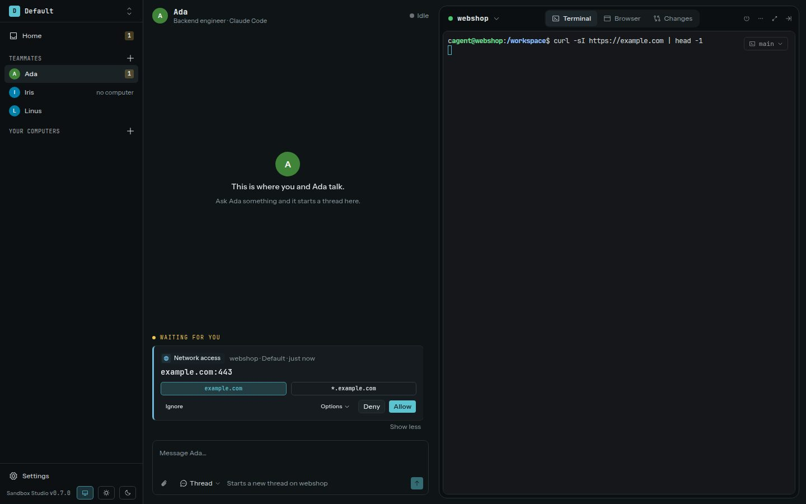
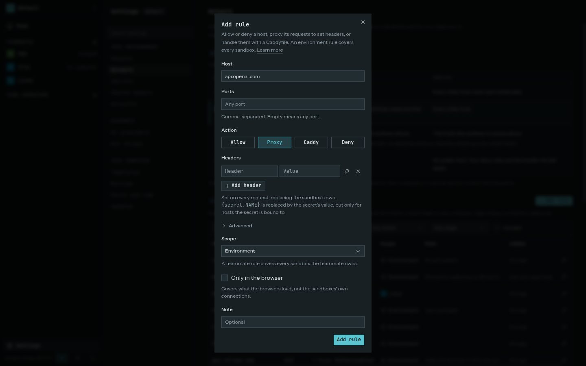

Every sandbox TCP connection goes through Studio's gateway, including connections made by Docker containers inside the sandbox. DNS uses Studio's resolver. UDP and ICMP are blocked; outbound connections are for public addresses.

## Unknown hosts wait for you

When a sandbox reaches a host not covered by a rule, Studio holds the connection and shows a request in the approval inbox. The request includes the host, port, sandbox, and teammate if there is one.

You can allow or deny the request, or add a rule with a wider scope. Studio holds the original connection for up to 60 seconds. If you allow it before the hold expires and the client is still waiting, Studio releases that same connection and the original operation continues. If the client gives up or the 60-second hold expires first, the connection closes; retry the operation after approval.



The Network page has three tabs. **Rules** sets the security level, lists your rules, grouped by domain, with search and filters for scope and action, and lists the curated hosts. **Requests** lists the connections waiting for your decision, and **Activity** lists the ones you already decided. To see which hosts one sandbox reached, open its **Connections** panel.

## Security levels

Each environment has a security level, set on the Network page's **Rules** tab. It decides what happens when no rule matches a host. Rules always win, whichever way they allow or deny.

| Level | When no rule matches |
| --- | --- |
| **Locked** | Ask for every host. |
| **Guarded** | Allow the curated hosts (see below) and ask for the rest. New environments start here. |
| **Assisted** | Allow the curated hosts. An AI reviewer decides the rest, and asks you when it is unsure. |
| **Open** | Allow public hosts and log them in Activity. Deny rules and the tracker list still apply. |

A teammate can have its own level, and **Environment default** follows the environment's. Environments that existed before levels were introduced are Locked, so nothing opens up on upgrade. At every level, a secret reaches only the hosts it is bound to, and a level never allows a private address.

## The curated list

The **Rules** tab lists the development hosts Studio allows at Guarded, Assisted and Open: package registries, toolchain downloads, container registries, read access to code forges, and content delivery networks. Each entry has a switch. Switch an entry off for an environment, and its hosts ask you like any other.

## Assisted and the AI reviewer

At Assisted, a host that no rule and no curated entry covers goes to an AI reviewer first. The reviewer answers from the host, the port, the page a browser request belongs to, and the sandbox's last prompt. It never sees secrets, request bodies, or secret placeholders. Its allow or deny lasts a day and appears in **Activity**, with a **Revert** that undoes it. Without a provider that has a utility model, Assisted asks you like Guarded does.

## Add a rule

On the Network page's **Rules** tab, choose **Add rule**. Enter a host such as `api.example.com` or `*.example.com`; a wildcard covers the root host and its subdomains. Add comma-separated ports, or leave ports empty to match every port. Choose whether the rule applies to the whole environment, one teammate, or one sandbox.



| Action | Use it for |
| --- | --- |
| **Allow** | Let matching connections through without a custom header rule. |
| **Proxy** | Let Studio handle HTTP and HTTPS requests and set request headers, such as an authorization header. |
| **Caddy** | Apply a restricted Caddyfile rule to rewrite, answer, or proxy HTTP requests. |
| **Deny** | Block matching connections. An environment-wide deny always wins. |

Check **Only in the browser** to limit a rule to the pages Studio's browser loads: the sandboxes' own connections to the host still ask, or follow their other rules. The Rules tab marks such rules **browser only**.

Environment-level deny rules take precedence as a safety boundary. Otherwise a sandbox-specific rule, then a teammate rule, then other environment rules are considered.

Proxy and Caddy rules handle HTTP and HTTPS requests inside Studio. Studio installs a per-environment certificate authority in each sandbox so it can intercept TLS for these rules. A host-bound secret also uses this path when Studio needs to replace its placeholder.

## Use a secret in a proxy rule

For a **Proxy** rule, enter a header value with a secret placeholder, for example `{secret.API_TOKEN}`. Studio replaces it only for HTTPS requests to a host that the secret is bound to. See [Secrets](../secrets/).

For a **Caddy** rule, the field accepts the body of a Caddy site block, not a full server configuration. This example proxies requests to an HTTPS API and adds a bound secret as a header:

```text title="Caddyfile"
reverse_proxy https://api.example.com {
  header_up X-Api-Key {secret.API_TOKEN}
}
```

Create the secret first and bind it to `api.example.com`. Studio checks Caddy rules before saving them. Rules support a limited set of request handlers and fixed public upstream hosts; imports, file access, environment lookups, extra listeners, and arbitrary Caddy modules are not available.

## This computer

Sandboxes never reach the computer Studio runs on, so `ssh you@192.168.178.63` or `curl localhost:3000` from a sandbox fails: `localhost` is the sandbox itself, and this computer's own addresses are refused. To let sandboxes reach a service here, open its port under **This computer** on **Settings → Network**. Sandboxes then connect to `host.studio.internal` on that port, for example `ssh you@host.studio.internal`, and Studio connects them to the port on this computer's loopback, so a service listening on `127.0.0.1` or `0.0.0.0` answers. Each connection still needs a rule for `host.studio.internal` or an approval; a security level never allows it. Studio's own ports stay closed.

## Local network

Sandboxes reach public addresses only, so a NAS at `192.168.178.20` or a company host behind a VPN, such as `git.company.local`, is unreachable by default. To let sandboxes reach one, add it under **Local network** on **Settings → Network**:

- A **name** or a wildcard such as `*.company.local`. Sandboxes use the name as it is.
- A **private IPv4 address**, such as `192.168.178.20`, or a **range**, such as `192.168.178.0/24`. Sandboxes can't connect to private addresses directly, so they use the name the list shows, `192-168-178-20.lan.studio.internal`; rules and approvals name the address itself.

Ports default to 80 and 443; list others, such as 22 for SSH. Each connection still needs a rule or an approval, never a security level. Approvals, rules, and imported environment files never add to the list, and loopback, link-local, and this computer's own addresses stay unreachable: use **This computer** for those.

## Rules no sandbox can reach

A rule for an address no sandbox can reach, such as `127.0.0.1`, this computer's own address, or a private address that isn't on the local network list, is saved, but it never applies. The Rules page marks such a rule with the reason and a link to the setting that changes it.

## Requests from the browser

When the browser asks for a host, the request card shows the page's request, such as `GET /npm/lib.js`. **Allow** and **Deny** make a rule that covers only the browser, so the agent can browse a site without its sandbox being able to download from it. To cover the sandboxes too, open **Options** and pick **Browser and sandboxes**.

To allow a host only for now, open **Options** and choose **Allow for this session**. The host, or the pattern you picked on the card, is then allowed in that teammate's browser until the browser stops, and no rule is added. A navigation to a new site also offers **Allow site … for this browser session**, which allows the site and the pages on it.

## Browser and Git approvals are separate

The network policy controls which hosts a sandbox can reach. Browser actions that change a page can also need a **browser action** approval. Git pushes to a forge configured in **Settings → Git** use **Git push** review. A network allow does not approve either of those actions. See [Browser](../browser/) and [Git review](../git-review/).
