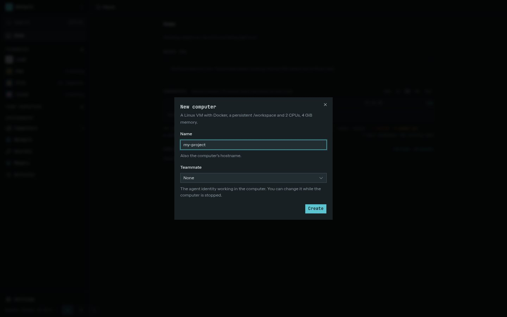
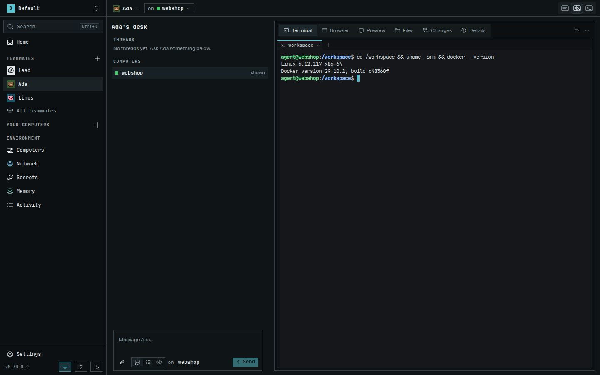
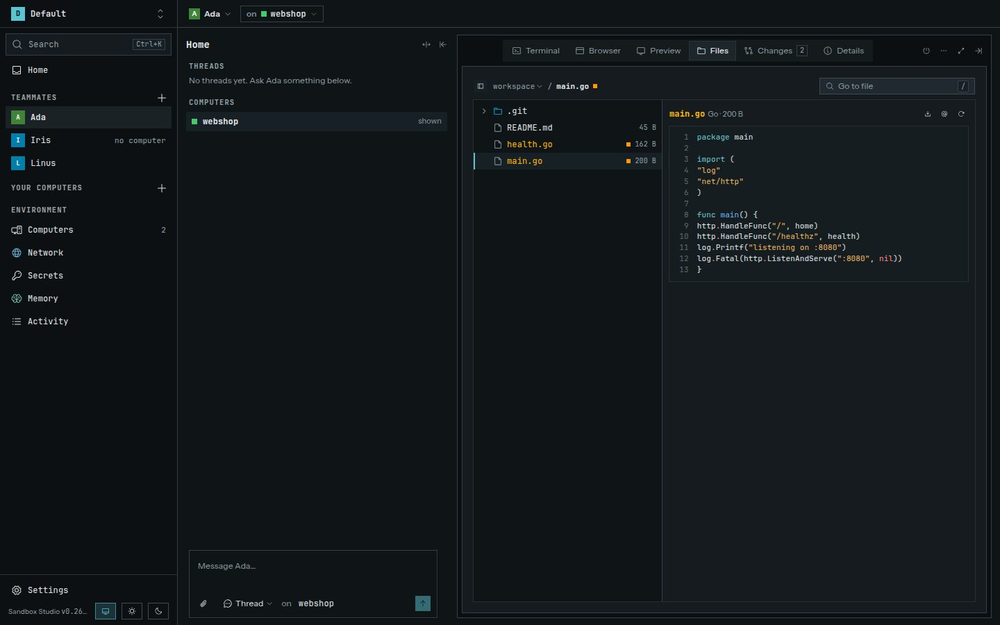
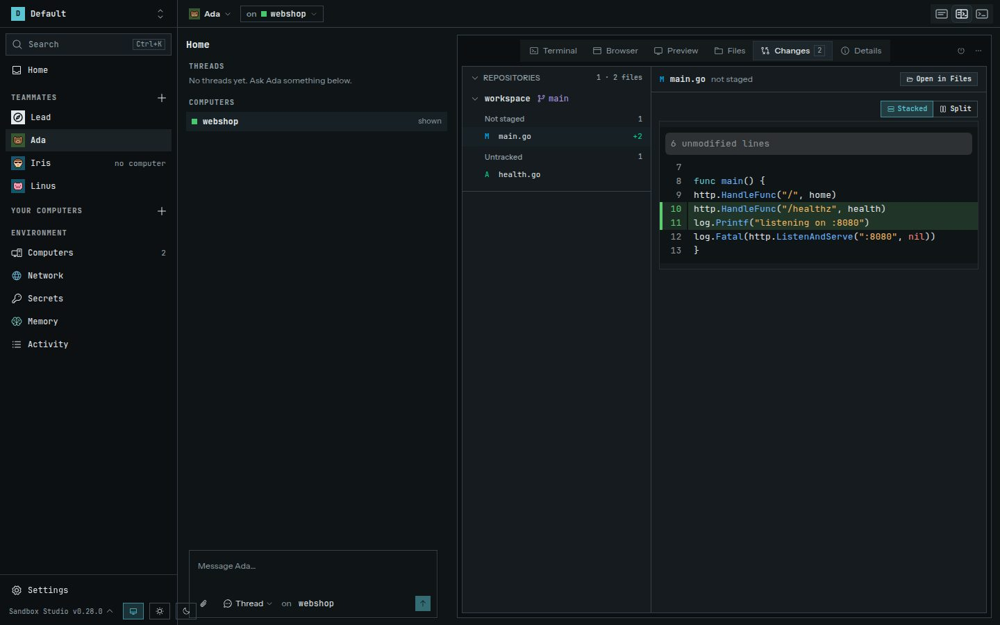

A computer is a sandbox: a Linux microVM with Docker, a persistent `/workspace`, and its own terminals. A teammate's computer is the one it works in, and **Your computers** in the sidebar are the ones without a teammate. **Computers** under **Environment** lists them all. Creating a computer boots it, and its name is also its hostname.

## Create one

1. Choose **+** next to **Your computers** in the sidebar, then **New computer**, or **New computer** on the **Computers** page. For a teammate, choose **Give Iris a computer** on its page, or **Give Iris another computer…** in the computer menu at the top of its page.
2. Enter a name of up to 40 lowercase letters, digits, and dashes.
3. Optionally choose a teammate. You can change it later on the computer's **Details** tab, while the computer is stopped. If you have [bases](#a-fresh-computer-per-task), **Start from** picks one, or **An empty computer**.
4. Select **Create**. Studio opens the computer's screen while it boots. The screen lists the creation steps and shows the progress of the image download. If a step fails, it shows the error and a **Delete** button.



You can also start from a ready template under **Settings → Templates**. A template sets up the root filesystem; a new computer still gets its own empty workspace and Docker disk. Its home directory (`/home/agent`, 4 GiB) starts from the template's home, so your agent's sessions and logins are kept on that disk.

## All computers

**Computers**, under **Environment** in the sidebar, lists every computer of the environment with its state, who uses it, the thread it is on, its disk use and when it was last active. Filter it to **Running** ones, **Yours** (those without a teammate) or **Bases**. It also has **New computer**, **Import** for a [`.studio-sandbox` file](#export-a-workspace), and **Rebase all…** while some computers are [built on an older base](#rebase-onto-a-newer-base).

## The computer's screen

On a teammate's page, its home is on the left: what waits for you, its threads, and its computers. Open one of its computers and it shows on the right, beside the home; open a thread and the chat takes the home's place. Drag the line between the two sides, or fold either one. A computer without a teammate, under **Your computers**, has the page to itself. **on my-app** at the top of the page switches between the teammate's computers and lists each fork under the computer it came from.

The screen's tabs are **Terminal**, **Browser** (the teammate's own [browser](../browser/)), **Preview** while [previews](#open-a-preview) are on, **Files**, **Changes** and **Details**. A dot on a tab marks something there that waits for you, and **1 request needs you** at the edge of the screen opens the [network requests](../network/) the computer holds. Beside the tabs are the power button, which stops or starts the computer, and the **⋯** menu. On a teammate's page, the layout switch at the right of the top bar folds the screen, shows it beside the conversation, or gives it the page.

### Terminals

Terminals run inside the computer at `/workspace`, one tab per session; the teammate's agent sessions are marked with a robot, and a dot while they work. **+** (Alt+Shift+T) opens a **New shell**, × closes a session after asking, and a double-click renames it. Alt+Shift+[ and Alt+Shift+] switch between them, and Alt+Shift+W closes the one in view. To run the teammate's agent in a terminal, start it in a shell, or press `T` in the [terminal UI](../tui/). Docker runs inside the computer and uses its persistent Docker disk. A link in a terminal opens in your browser; a link to a port of the computer, such as `http://localhost:5173`, opens as a preview.



To copy from a terminal, drag across the text: it is copied when you let go. Right-click opens **Copy** and **Paste**. With the keyboard, Ctrl+Shift+C copies a selection made with Shift-drag (⌘C on a Mac, with Option-drag), and Ctrl+V or ⌘V pastes. Pasting or dropping a picture or a file saves it in the computer and types its path. Programs in the computer can put text on your clipboard but can't read it.

Terminals start bash. To use zsh, set **Settings → General → Terminal shell** to zsh: new terminals in every computer start it, and the ones that are open keep their shell. zsh gets the same environment as bash, with history and completion set up; put your own settings in `~/.zshrc`. Agents run bash either way. A computer created from an older image has no zsh and keeps starting bash until you rebase it onto the current one.

### Files

**Files** shows the computer's files as a tree beside the file open. It starts at `/workspace`; the first part of the path switches to `/tmp`, the whole computer, or any path with **Go to a path…**. The folders you open stay open, the path above links each folder, and **Go to file** (or **/**) finds a file by its name. **Hide the tree** gives the file the whole width, and in a narrow panel the tree opens over the file. Back and Forward step through the places Files showed. An open file has **Download**, **Mention in chat**, which puts its path in your message, and **Refresh**. Files can't be edited here: ask your teammate, so that [undo](../chat/#undo-a-change) stays accurate.

To copy files into the computer, drop them on the folder shown, or choose **Upload into …**. They go in one at a time, each with its progress and a cancel button, and a file can be as large as the free space on the workspace's disk. If a name is taken, you choose whether to replace the file or keep both. Uploads go into the workspace only.



### Changes

**Changes** lists what changed beside the change you pick:

- **Needs you**: pushes that wait for your [review](../git-review/).
- **Pushed**: the last day's pushes, with their pull request, its checks and its comments.
- **Repositories**: each repository's branch, with the files that are staged, not staged and untracked.
- **This thread**: the files each request of the open thread created, changed or deleted, which you can [undo](../chat/#undo-a-change).

A file opens its diff, **Stacked** or **Split**, with **Open in Files**.



### Details

**Details** shows the computer itself: its state, CPU and memory use, its disks, the ports it listens on, how to reach it, its latest checkpoints and where it came from. **Maintenance**, at the bottom, has the actions that change it: rebase, fork, use as a base, merge, export and delete.

## Stop, suspend, and resume

The power button stops a running computer and starts one that is off; a computer that is off shows a dark screen with **Start** (or **Resume**), its last checkpoint and what it keeps. The **⋯** menu has **Checkpoint now**, **Fork…**, **Connect over SSH**, **Suspend** (or **Resume**) and **Delete**. Everything else is on the **Details** tab:

| Action | Where | What it does |
| --- | --- | --- |
| **Stop** | the power button | Powers off the VM. Files on its disks stay, but running processes and terminal sessions end. **Start** boots it again. |
| **Suspend** | **⋯** | Pauses a running VM with its memory and processes. **Resume** continues it, including terminal sessions. Suspended memory does not survive a host reboot. |
| **Checkpoint now** | **⋯**, or **Checkpoints** on Details | Saves a [checkpoint](../checkpoints/) of the computer as it is. **All checkpoints and history…** shows where it came from and its checkpoints. |
| **Fork** | **⋯**, or **Maintenance** | Copies the computer into a new one with the same template and resources, then starts it. `/workspace` and the home directory are always copied; see [A fresh computer per task](#a-fresh-computer-per-task) for Docker's data and tools. What was installed elsewhere, such as apt packages, isn't. The fork gets its own network approvals. |
| **Use as a base** | **Maintenance** | Makes it a starting point for new computers (see below). |
| **Merge into** | **Maintenance**, on a fork | Merges a fork's changes back (see below). |
| **Teammate** | **Reach it** | Changes who works in it, while it is stopped. |
| **Connect over SSH** | **⋯**, or **Reach it** | Shows its SSH commands (see below). |
| **Connections** | **Reach it** | Lists where the computer connects. **Record intercepted traffic** keeps, for 15 minutes, the HTTP requests Studio handles for it (a browser's pages, proxy and Caddy rules, hosts with secrets) with their headers and bodies, and secret values masked. They stay in memory only and go an hour after recording stops, or on **Clear**. |
| **Resources** | **State** | Changes its CPUs and memory (see below). |
| **Resize** | **Disks** | Changes the size of the workspace, Docker and home disks (see below). |
| **Rebase** | **Maintenance** | Moves the computer onto the current base image or another template (see below). |
| **Export** | **Maintenance** | Saves a portable copy (see [Export a workspace](#export-a-workspace)). |
| **Delete** | **⋯**, or **Maintenance** | Permanently removes the computer, its disks and its checkpoints. Export it first if you need a portable backup. |

If microsandbox loses the record of a computer's VM, the screen says so and offers **Repair**, which gives the VM a new record around the disks it kept. See [Troubleshooting](../troubleshooting/#a-sandbox-says-microsandbox-lost-its-vm).

A running computer takes a change of CPUs or memory right away, up or down, while it fits the room it started with: twice its memory, and its CPUs plus as many again (at most 4 more). The dialog says per resource whether a value applies now or needs a restart. A change past that room waits for the next start, and the **State** card shows it, such as *2 CPU · 4 GiB · 12 GiB after restart*. **Save and restart** applies all of it now; programs and terminal sessions end, files stay. A stopped or suspended computer takes any change at its next start.

A disk can't change its size in place, so **Resize…** gives the computer a new generation with the sizes you pick and copies `/workspace`, the home directory and Docker's images, containers and volumes into it. A disk can also shrink, as long as what it holds fits. A running computer stops for the copy and starts again; a big Docker disk takes a while. As with a rebase, apt packages, tools from `mise use -g` and terminal sessions are not carried over. When a disk is nearly full, the strip above the screen or chat that says so has a **Resize disks…** button. A computer from a template built before the home directory existed keeps its home on the root disk, so only its workspace and Docker disks can be resized. If the resize fails, the computer keeps its disks and the page names the step that failed.

### Rebase onto a newer base

Rebasing moves the computer onto the current base image, which is what new computers get, or onto a ready template, and carries over `/workspace`, the home directory with your logins and harness sessions, and the tools from `mise use`. Apt packages and terminal sessions are not carried over, and neither are Docker's images, containers and volumes unless you tick **Keep Docker's images, containers and volumes**, which takes a while: up to 15 minutes for 10 GB.

Each Studio release can bring a newer base image, with newer harnesses and chat adapters and Debian's security updates. A computer made from an older one says so: its **Details** tab shows *Built on an older base* with **Rebase…**, and Home lists it, with **Rebase all…**, until you dismiss the notice. A computer from a template is brought up to date by rebasing it onto its template rebuilt on the current base: **Settings → Templates** offers **Rebuild on the current base** for a template that is behind. The rebase runs in the background: the computer's screen shows its steps as for a new computer. If it fails, the computer stays on its old template and the page names the step that failed until you dismiss it. See [Templates](../templates/) and the [rebase guide](https://github.com/lukaskoebe/sandbox-studio/blob/main/docs/rebase.md).

## See a computer's history

On the **Details** tab, **All checkpoints and history…** under **Checkpoints** opens *History and checkpoints*. It draws the computer's history as a line from left to right, in the order things happened.

- Each generation of the computer is labelled with its template. A rebase shows as a change of template, a disk resize as *disks resized*, and a restore as a jump back to a checkpoint.
- Checkpoints are the points on the line. Select one for its menu: **Restore** and **Fork from here**, which wait on a fix in microsandbox for now (see [Checkpoints](../checkpoints/#restore-is-currently-unavailable)), **Rename** and **Delete**.
- Forks branch off to their child computers, and a forked computer shows the one it came from. A deleted computer stays in the history, marked as deleted.
- The end of the line is the computer as it is now. **Save checkpoint** in the **Checkpoints** section below saves its current state.

The computer menu at the top of a teammate's page, and **Computers**, show each fork under the computer it was made from.

## Merge a fork back

On a fork's **Details** tab, **Maintenance** has **Merge into** followed by the name of the computer it was forked from. Start the fork first: Studio reads its changes while it runs.

Studio makes a scratch copy of the original computer, named like `my-app-merge-1`, and merges the fork's changes into that copy. The original isn't touched until you accept. The merge page lists what it did:

- Files in `/workspace` and the home directory that only the fork changed come over as they are. A text file both sides changed is merged line by line, and lines both changed get conflict markers.
- Commits arrive as new branches named `fork/<fork>/<branch>`, so no branch of the original is overwritten.
- Tools the fork installed with mise, cargo or go are copied if the original lacks them.
- Caches, ignored files and Docker state are left out.

If there are conflicts, open the scratch computer and resolve them, or copy the prompt on the merge page into a chat with its teammate. Run the tests there if you like, then **Check again**. **Accept** copies the result into the original and deletes the scratch copy. It can't be undone, as Studio takes no checkpoint first. **Abort** deletes the scratch copy and leaves the original as it was.

A fork made before Studio 0.6 doesn't know what it started from, so every file the two sides hold differently is a conflict.

## Open a preview

Previews are off unless you turn on **Previews** under **Settings → General**, for every environment at once. While they are off, the screen has no **Preview** tab, links to a computer's ports in an agent's messages are plain text, and a preview opened from a link says previews are off, with a way to turn them on.

If a web server is listening on a computer's port, open the screen's **Preview** tab and choose the port, or choose **Preview** next to it under **Ports and previews** on the **Details** tab. The preview has a bar of its own: Back, Forward and Reload, the port, which switches to another, a path to type after it, the pages visited in this preview, **Reload fresh**, and **Open in new tab** for apps that refuse to be framed. A link to another port of the computer switches to that port. Studio opens a host-scoped `.localhost` link through the agent channel. The link is meant for the browser on the machine running Studio. A site that asks for a password gets a sign-in prompt.

Studio removes its own authentication cookies before forwarding preview requests and filters Studio cookies from preview responses. The preview app's own cookies are retained. Preview links do not expose the computer to your LAN.

Service workers work in previews, module workers included, such as the one Vite's PWA plugin registers during development.

Each port keeps its own browser storage, so a service worker an app registered stays after the app stops, and may keep serving it to whatever runs on the port next. **Reload fresh** clears the preview's caches, storage and service workers before it opens again. Its cookies stay.

An agent can list the ports itself with `studio info` in a terminal, which also tells it the computer's security level and the network rules that cover it.

## Connect over SSH

Any SSH client can reach a computer: `ssh`, `scp`, `sftp`, and editors that work over SSH, such as VS Code Remote-SSH, Cursor, Zed and JetBrains Gateway. Turn on **SSH access** under **Settings → General**, or run `studio ssh enable`. Studio adds one `Include` line at the top of `~/.ssh/config`, for a file Studio keeps up to date with a host per computer. Then a computer named `my-app` is `my-app.studio`:

```sh
ssh my-app.studio
scp -r ./src my-app.studio:/workspace/
```

Your editor lists the `.studio` hosts among its SSH hosts. **Connect over SSH** in the computer's **⋯** menu, or **Connect…** under **Reach it** on its **Details** tab, shows its commands and opens it in VS Code or Cursor. Studio must be running. A stopped computer starts and a suspended one resumes when you connect. A name that computers of two environments share gets the computer's ID added, as in `my-app-k2x9….studio`, and `<id>.studio` always works.

Studio uses its own key and host key, so none of your keys are needed or changed. You log in as `agent`; `ssh root@my-app.studio` logs in as root. An SSH session has the terminal's environment, such as the CA variables, secret placeholders and mise: an interactive one opens your terminal shell at `/workspace`, and a command runs through `bash -l` in the home. A computer created before Studio 0.17 keeps `/bin/sh` without that environment until you rebase it; there, run `ssh -t my-app.studio bash -l`. An editor that installs a server in the computer, as VS Code and JetBrains Gateway do, downloads it through the computer's network rules, so allow the request if Studio asks. It lands in the home, so give the home more room if it's short (**Resize…** under **Disks** on the **Details** tab), and a fork brings it along. `scp` copies the files but then reports an error, because of a fault in microsandbox's SFTP server; `sftp` doesn't.

If a dotfile manager such as home-manager keeps `~/.ssh/config` read-only, Studio says which `Include` line to add there yourself. `studio ssh disable` and the switch remove it.

## A fresh computer per task

Keep one computer prepared, with your repositories in `/workspace`, your tools, your Docker images and your shell set up, and copy it for each task. On its **Details** tab, choose **Use…** next to **Use as a base** to say what a copy takes:

- **Docker's images, containers and volumes.** This takes as long as they are big, and the computer has to be stopped, so keep a base stopped. Studio won't stop it for you.
- **The tools installed with `mise use`.** Software installed in other ways, such as apt packages, isn't copied.
- **Running `~/.config/studio/on-fork.sh`.** The script runs in a terminal named `on-fork` once the copy is up, starting in `/workspace`. You can read its output there, and it ends with the status it finished with. Studio only runs it if you ask for it here or in the fork dialog. For example, to bring every repository up to date:

  ```sh
  for repo in /workspace/*/.git; do
    git -C "${repo%/.git}" fetch --prune && git -C "${repo%/.git}" pull --rebase
  done
  ```

A base gets a small **base** mark, and its row becomes **Base settings** with **Change…**. **New computer** then has a **Start from** field listing your bases, **Fork** starts with the same choices, which you can change for that copy, and **Computers** lists them under **Bases**.

A copy keeps the base's template and resources. Its teammate is the base's unless you pick another, or **None**, so one base can serve several teammates. The home is copied as it is, so the base's harness history and logins come along whoever owns the copy. A copy has its own network approvals, so a host you allowed for the base alone isn't allowed for the copy. To allow a host or give a secret to every copy, scope the rule or secret to the teammate.

Each copy is a full copy on your disk, as Studio can't share data between them yet. A computer gives one copy at a time, and it shows as running while it does.

## Export a workspace

Choose **Export** under **Maintenance** on the **Details** tab to save a `.studio-sandbox` file that can be imported in another environment or Studio install, with **Import** on **Computers**, or **+** next to **Your computers** and **Import a computer**. It contains the template specification, resource settings, `/workspace`, and the home directory (`/home/agent`), which holds your agent's sessions and anything you saved there. Read the home directory before you share the file. It does not include secrets, approvals, Git credentials, checkpoints, or Docker data. A live export is not frozen; stop the computer first for a consistent copy. See [Export and import](https://github.com/lukaskoebe/sandbox-studio/blob/main/docs/export-import.md).
