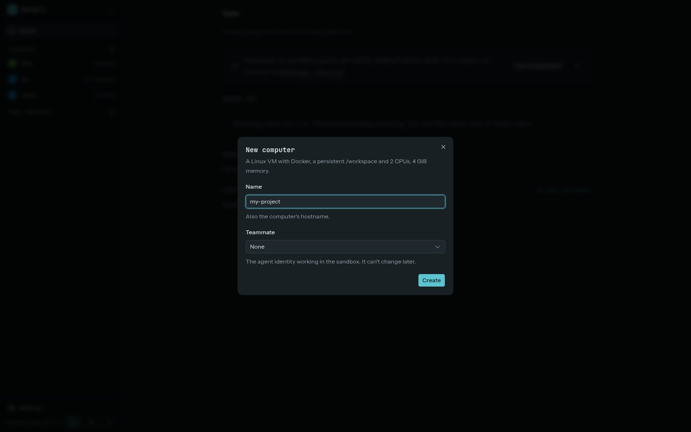
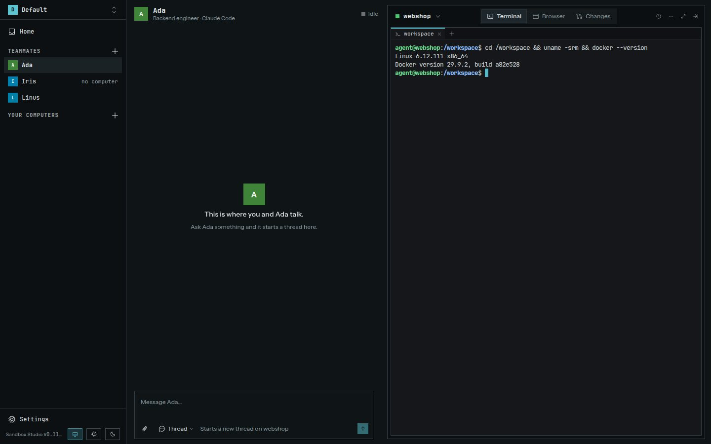

A sandbox is a Linux microVM with Docker, a persistent `/workspace`, and its own terminal. Studio's pages call it a computer: a teammate's computer is the sandbox it works in, and **Your computers** are the sandboxes without a teammate. Creating a sandbox boots it. Its name is also its hostname in Studio.

## Create one

1. Choose **+** next to **Your computers** in the sidebar, then **New computer**. For a teammate, use the offer on its page to give it one, or **Another computer for** it in its computer's **⋯** menu.
2. Enter a name using lowercase letters, digits, and dashes.
3. Optionally choose a teammate. This choice cannot be changed later.
4. Select **Create**. Studio opens the computer's screen while it boots. The screen lists the creation steps and shows the progress of the image download. If a step fails, it shows the error and a **Delete** button.

You can create a blank sandbox or choose a ready template from **Settings → Templates**. A template sets up the root filesystem; a newly created sandbox still gets its own empty workspace and Docker disk. Its home directory (`/home/agent`, 4 GiB) starts from the template's home, so your agent's sessions and logins are kept on that disk.

## The computer's screen

A teammate's computer shows on the right of the teammate's page, beside your conversation with it. A computer without a teammate, under **Your computers** in the sidebar, has the page to itself. The top of the screen names the computer and switches between the teammate's computers. Its tabs are **Terminal**, **Browser** (the teammate's own [browser](../browser/)), **Preview** while [previews](#open-a-preview) are on, and **Changes**; a dot on a tab marks something there that waits for you. Beside them are the power button, which stops or starts the computer, and the **⋯** menu with its template, CPUs, memory and uptime, and while it runs its CPU and memory use. The arrow at the top right folds the screen into a strip of tab icons. On a narrow window it is that strip, and a tab opens over the conversation.

Terminals run inside the sandbox at `/workspace`. The chip at the top of the terminal names the session in view and lists the others, the teammate's agent sessions marked with a robot; from it, open a **New shell** or the teammate's agent in a terminal, or close the session. Docker runs inside the sandbox and uses its persistent Docker disk. **Changes** shows a push that waits for your review, what the open thread changed, and the computer's files. To copy files in, drop them onto **Files** or choose **Upload…** from its folder menu. They go into the folder shown, up to 100 MiB each. If a name is taken, you choose whether to replace the file or keep both.

To copy from a terminal, drag across the text: it is copied when you let go. Right-click opens **Copy** and **Paste**. With the keyboard, Ctrl+Shift+C copies a selection made with Shift-drag (⌘C on a Mac, with Option-drag), and Ctrl+V or ⌘V pastes. Programs in the sandbox can put text on your clipboard but can't read it.

## Stop, suspend, and resume

The power button stops a running computer and starts one that is off; a computer that is off shows a dark screen with **Start** (or **Resume**) and what it keeps. The **⋯** menu has these actions:

| Action | What it does |
| --- | --- |
| **Checkpoint now** | Saves a [checkpoint](../checkpoints/) of the sandbox as it is. |
| **Checkpoints** | Shows where the sandbox came from and its checkpoints. |
| **Stop** (the power button) | Powers off the VM. Files on its disks stay, but running processes and terminal sessions end. Use **Start** to boot it again. |
| **Suspend** | Pauses a running VM with its memory and processes. **Resume** continues it, including terminal sessions. Suspended memory does not survive a host reboot. |
| **Fork** | Copies the sandbox into a new one with the same template and resources, then starts it. `/workspace` and the home directory are copied; Docker images, containers and volumes are not, nor is what was installed elsewhere, such as apt packages and tools from `mise use -g`. The fork gets its own network approvals. |
| **Connections** | Lists where the sandbox connects. |
| **Resources** | Changes its CPUs and memory (see below). |
| **Rebase** | Moves the sandbox onto another template (see below). |
| **Export** | Saves a portable copy (see [Export a workspace](#export-a-workspace)). |
| **Delete** | Permanently removes the sandbox and its disks. Export the sandbox first if you need a portable backup. |

A change of CPUs or memory applies the next time the sandbox starts: the microsandbox version Studio uses can't resize a running VM, so stop and start a running sandbox to get it.

Rebasing changes the template and carries over `/workspace` and the home directory; Docker data and terminal sessions are not carried over. The rebase runs in the background: the computer's screen shows its steps as for a new sandbox. If it fails, the sandbox stays on its old template and the page names the step that failed until you dismiss it. See [Templates](../templates/) and the [rebase guide](https://github.com/lukaskoebe/sandbox-studio/blob/main/docs/rebase.md).

## See a sandbox's history

**Checkpoints** in the **⋯** menu opens the sandbox's history. It draws the sandbox's history as a line from left to right, in the order things happened.

- Each generation of the sandbox is labelled with its template. A rebase shows as a change of template, and a restore shows as a jump back to a checkpoint.
- Checkpoints are the points on the line. Select one for its menu: **Restore** when the runtime allows it, **Fork from here**, **Rename** and **Delete**.
- Forks branch off to their child sandboxes, and a forked sandbox shows the one it came from. A deleted sandbox stays in the history, marked as deleted.
- The end of the line is the sandbox as it is now. **Save checkpoint** in the **Checkpoints** section below saves its current state.

On a teammate's page, the switcher at the top of the screen shows each fork under the computer it was made from.

## Merge a fork back

A fork's **⋯** menu has **Merge into** followed by the name of the sandbox it was forked from. Start the fork first: Studio reads its changes while it runs.

Studio makes a scratch copy of the original sandbox, named like `my-app-merge-1`, and merges the fork's changes into that copy. The original isn't touched until you accept. The merge page lists what it did:

- Files in `/workspace` and the home directory that only the fork changed come over as they are. A text file both sides changed is merged line by line, and lines both changed get conflict markers.
- Commits arrive as new branches named `fork/<fork>/<branch>`, so no branch of the original is overwritten.
- Tools the fork installed with mise, cargo or go are copied if the original lacks them.
- Caches, ignored files and Docker state are left out.

If there are conflicts, open the scratch sandbox and resolve them, or copy the prompt on the merge page into a chat with its teammate. Run the tests there if you like, then **Check again**. **Accept** takes a checkpoint of the original, so you can go back, copies the result into it and deletes the scratch copy. **Abort** deletes the scratch copy and leaves the original as it was.

A fork made before Studio 0.6 doesn't know what it started from, so every file the two sides hold differently is a conflict.

## Open a preview

Previews are off unless you turn on **Previews** under **Settings → General**, for every environment at once. While they are off, the screen has no **Preview** tab, and links to its ports in an agent's messages are plain text.

If a web server is listening on a sandbox port, open the screen's **Preview** tab and choose the port. **Open in new tab** opens it in a tab of its own, for apps that refuse to be framed. Studio opens a host-scoped `.localhost` link through the agent channel. The link is meant for the browser on the machine running Studio.

Studio removes its own authentication cookies before forwarding preview requests and filters Studio cookies from preview responses. The preview app's own cookies are retained. Preview links do not expose the sandbox to your LAN.

Each port keeps its own browser storage, so a service worker an app registered stays after the app stops, and may keep serving it to whatever runs on the port next. Choose **Reload fresh** on the **Preview** tab to clear the preview's caches, storage and service workers before it opens. Its cookies stay.

An agent can list the ports itself, with the `sandbox_info` tool of Studio's MCP server or `studio-agent info` in a terminal; the same tool tells it the sandbox's security level and the network rules that cover it.

## Export a workspace

Use **Export** in the **⋯** menu to save a `.studio-sandbox` file that can be imported in another environment or Studio install, with **+** next to **Your computers** and **Import a computer**. It contains the template specification, resource settings, `/workspace`, and the home directory (`/home/agent`), which holds your agent's sessions and anything you saved there. Read the home directory before you share the file. It does not include secrets, approvals, Git credentials, checkpoints, or Docker data. A live export is not frozen; stop the sandbox first for a consistent copy. See [Export and import](https://github.com/lukaskoebe/sandbox-studio/blob/main/docs/export-import.md).
