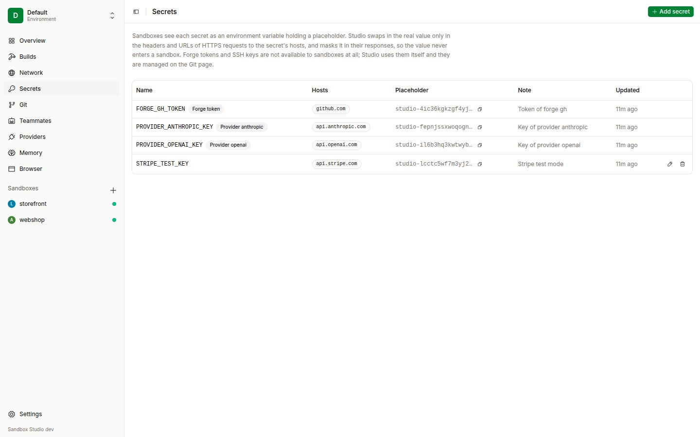

Secrets belong to one environment and stay on the host. Studio encrypts them in its vault. Their master key is kept in the OS keychain when available, or in an owner-only file otherwise.

## Add a secret

Choose **Secrets → Add secret**, then enter:

- **Name:** the environment variable name a sandbox will see, such as `SERVICE_TOKEN`;
- **Value:** the actual key or credential;
- **Hosts:** the hosts where Studio is allowed to send the value, such as `api.example.com`;
- **Note:** an optional reminder.

Studio returns placeholders to sandboxes instead of secret values. For HTTPS requests, the gateway checks request headers and URL paths and queries. It replaces a known placeholder only when the destination host is allowed for that secret; if an inspected header or URL contains a known placeholder for a secret that is not bound to that host, Studio refuses the request. Placeholder substitution in request bodies is not supported.

For intercepted HTTP responses, Studio attempts to mask exact matches for secret values in headers and bodies. This is a safeguard, not a guarantee: shortened, encoded, or otherwise transformed values may not match. Avoid pasting real values into instructions, commands, or project files. A service you call receives the credential, so bind each secret only to hosts that need it and use the narrowest host pattern that works.

## Change a secret

Use the edit control to replace a value, change its allowed hosts, or update its note. Deleting it removes it from the environment. If an agent needs the changed value, start a new session or retry its request after the secret update.

Provider API keys and Git forge credentials are managed on their own pages. Studio-only Git credentials cannot be added to sandbox requests. See [Teammates and providers](../teammates-providers/) and [Git review](../git-review/).
