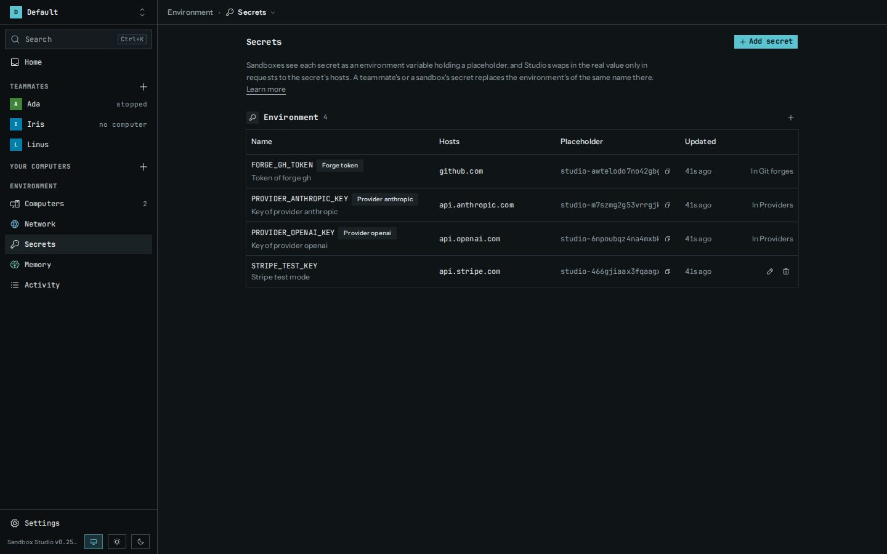

Secrets belong to an environment, a teammate or a single sandbox, and stay on the host. Studio encrypts them in its vault. Their master key is kept in the OS keychain when available, or in an owner-only file otherwise. While the keychain is locked, Studio waits for it ([Troubleshooting](../troubleshooting/#studio-asks-you-to-unlock-your-keychain)).

## Add a secret

Open **Secrets** under **Environment** in the sidebar and choose **Add secret**, then enter:

- **Kind:** **Value** for a key or token sent as it is, or **AWS access key** (see below);
- **Name:** the environment variable name a sandbox will see, such as `SERVICE_TOKEN`, in capitals, digits and `_`;
- **Value:** the actual key or credential, sealed on arrival and never shown again;
- **Hosts:** the hosts where Studio is allowed to send the value, such as `api.example.com`;
- **Scope:** the sandboxes that see it: every sandbox in the environment, every sandbox of one teammate, or one sandbox;
- **Note:** an optional reminder.

The list's **Placeholder** column shows what sandboxes get in place of the value.

Studio returns placeholders to sandboxes instead of secret values. For HTTPS requests, the gateway checks request headers, the user name and password of Basic authorization, and URL paths and queries. It replaces a known placeholder only when the destination host is allowed for that secret; if an inspected header or URL contains a known placeholder for a secret that is not bound to that host, Studio refuses the request. Placeholder substitution in request bodies is not supported.

For intercepted HTTP responses, Studio attempts to mask exact matches for secret values in headers and bodies. This is a safeguard, not a guarantee: shortened, encoded, or otherwise transformed values may not match. Avoid pasting real values into instructions, commands, or project files. A service you call receives the credential, so bind each secret only to hosts that need it and use the narrowest host pattern that works.

## AWS access keys

Some clients don't send a credential as it is: AWS's CLI and SDKs sign every request with the secret key, so a placeholder can't stand in for it, and Studio refuses such a request with a message saying what to do. For these, choose a **Kind** when you add the secret. Studio keeps the key and gives the sandbox short-lived credentials made from it, which the tool asks for itself.

For **AWS access key**, enter the access key ID and secret access key, and optionally:

- **Role to assume:** a role ARN. Sandboxes then get that role's session credentials (`AssumeRole`); without one, session credentials of the key's own user (`GetSessionToken`).
- **STS region:** the region whose STS endpoint to ask, for keys or roles that need a regional endpoint.

The secret's name becomes an AWS profile, in lower case, in the sandbox's `~/.aws/config`; Studio adds it there without touching the rest of the file. When a sandbox sees one AWS secret, `AWS_PROFILE` selects it, so `aws` and the SDKs use it without further setup; with several, choose one with `--profile` or `AWS_PROFILE`.

The first time a sandbox asks for credentials, a **Credentials** card waits for you on Home, and the count at the top right of Studio's other pages lists it: **Allow until it stops** lets that sandbox have them until it stops, **Always for** a teammate lets every sandbox of that teammate have them, and **Deny** refuses; for a sandbox without a teammate, **Always** is for that sandbox only. The credentials last an hour and the tools renew them on their own; the sandbox never sees the access key itself.

Kinds for other services that sign their requests will follow.

## Scopes

A sandbox sees the secrets of its environment, of the teammate that owns it, and those scoped to the sandbox itself. When the same name is set at several scopes, the sandbox gets the most specific one, so each teammate can have its own `GITHUB_TOKEN`. A request that uses the placeholder of a secret the sandbox doesn't see is refused.

The **Secrets** page lists them in a section per scope: **Environment** first, then each teammate and each sandbox by name, and each teammate's [browser logins](../browser/#save-logins), which only its browser uses and which show the username instead of a placeholder, with **Copy password**. The **+** button of a section adds a secret with that scope already chosen.

In a teammate's settings, **Secrets** under **Routine and access** lists everything its sandboxes see: the teammate's own secrets, those of its sandboxes, and the environment's ones, marked **Inherited**. A teammate's secret that has the same name as an environment one says that it replaces it, and the inherited one shows which teammate secret replaces it. **Add secret** there adds a secret for that teammate.

## Change a secret

Use the edit control to replace a value, change its allowed hosts, or update its note. The name and scope stay the same; to change them, delete the secret and add it again. Deleting it removes it from the environment. The placeholder stays the same too, so a new value applies from the sandbox's next request.

When a host answers **401 Unauthorized** three times within ten minutes to requests that carried a secret, Home shows a card saying the host keeps refusing it: the value is probably wrong or expired, which the sandbox can't tell because it only sees the placeholder. **Update secret** opens the secret's edit dialog; for a provider's API key, **Update key** opens **Settings → AI providers**. **Not now** stops asking about that secret and host for a day.

Provider API keys and Git forge credentials show in the list too, marked **Provider**, **Forge token** or **Forge SSH key**, with a link to **Settings → AI providers** or **Settings → Git forges**, where you change them. Studio-only Git credentials cannot be added to sandbox requests. See [Teammates and providers](../teammates-providers/) and [Git review](../git-review/).
