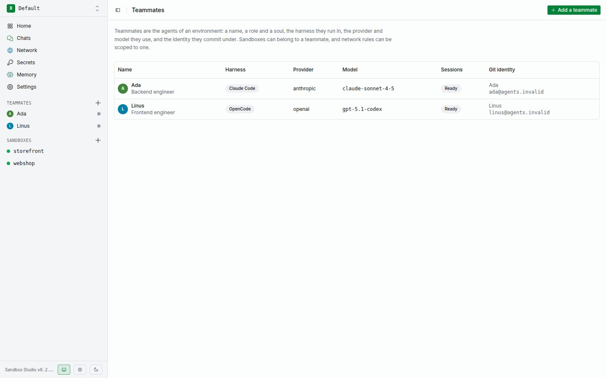
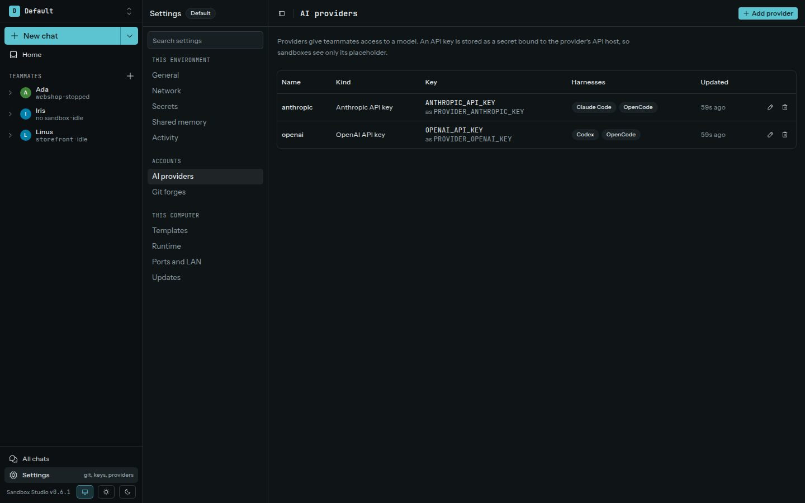

A teammate is an agent identity in one environment. It has a name, role, avatar, optional Markdown instructions (“soul”), harness, provider, model, and Git author name and email. **New rules from approvals apply to** sets the scope its approval cards preselect: this sandbox, this teammate, or the environment. One teammate can own multiple sandboxes; a sandbox's owner is selected at creation and cannot be changed later.

Each teammate has a page of its own, reached from **Teammates** in the sidebar. It opens on your conversation with the teammate: its recent chats in brief, what it learned, its tasks and the approvals it waits for, in one thread. Below it, send a message, hand over a task that it starts on right away, or teach it something to remember. The other tabs hold its tasks, chats, private memory, browser, and settings, where you edit it or delete it. To use the same teammate in another environment, choose **Copy to environment…** in its options menu; its sandboxes, chats, memory, secrets and keys stay behind.

## Choose a provider

Studio supports these providers:

| Provider | Harnesses |
| --- | --- |
| Anthropic API key | Claude Code, OpenCode |
| OpenAI API key | Codex, OpenCode |
| OpenAI-compatible HTTPS endpoint | Codex, OpenCode |
| Claude Pro/Max subscription | Claude Code |
| ChatGPT Plus/Pro subscription | Codex |

An OpenAI-compatible endpoint needs a public HTTPS base URL and a model. If you choose Codex, the endpoint must support the OpenAI Responses API.

Claude Pro/Max and ChatGPT subscriptions sign in from the provider dialog: Studio runs the vendor's own login in a short-lived VM and keeps the token on the host; sandboxes get placeholders only. A Claude subscription works in terminal sessions and in chats.

A subscription is not an API key. With an API key you paste the key and are done; with a subscription you sign in with your account in the browser and there is no key to paste. Add the provider, or choose **Sign in** next to it under **Settings → AI providers**, then follow the steps in the dialog:

- **Claude Pro/Max:** open the sign-in page, sign in and choose Authorize, copy the code the page shows, and paste it into the dialog's code field (or press **Paste**). Studio hands the code to Claude Code and saves the sign-in by itself; you don't type into the terminal. **Show the terminal** displays what Claude Code says, and opens by itself if it rejects the code. If you'd rather, run `claude setup-token` on your own computer and paste the `sk-ant-oat…` token it prints under **Use a token from claude setup-token instead**.
- **ChatGPT Plus/Pro:** open the sign-in page, enter the code the dialog shows, and sign in. Studio notices when you're done; there is nothing to paste back.

Add or rotate provider keys under **Settings → AI providers**. The key remains in Studio's host-side vault; the guest receives a placeholder, which Studio substitutes only for the provider's bound API host. Provider keys are managed with the provider and cannot be edited from **Settings → Secrets**.

## Default teammate

If an environment has no teammates when you add a provider, Studio adds a teammate named Iris on that provider. Iris is a generalist engineer that uses Claude Code with an Anthropic key or a Claude subscription, Codex with an OpenAI key or a ChatGPT subscription, or OpenCode with a custom endpoint. The Git identity is `Iris (agent) <iris@agents.invalid>`. Iris is an ordinary teammate: you can edit or delete Iris. Studio adds Iris again only when the environment has no teammates and you add another provider.

## Start a teammate session

1. Add a provider and enter its API key, or sign in with a subscription.
2. Add a teammate and select a supported harness, provider, and model. A teammate needs a provider for its model: in an environment without one, **New teammate** says so and leads to **Settings → AI providers**.
3. Create a sandbox and assign that teammate.
4. Open the sandbox and choose **Start session**. Studio opens the harness in a terminal tab.

To work with the teammate in a chat instead, see [Chat mode](../chat/).

The provider key must be bound to the correct API host, and the sandbox must be running. A sandbox without a teammate still has a terminal, but it cannot start an agent session or use teammate memory/browser tools.

Studio sets up the harness inside the sandbox. The teammate's name, role, and soul appear in its managed instruction file. The harness configuration uses the provider placeholder; it does not contain the real key. Changes to the teammate instructions take effect on the next session start.

## Tasks and check-ins

The **Tasks** tab lists the work a teammate should do. A task has a title, optional details in Markdown, and an optional due day. You add, edit, and mark tasks done; the teammate can add tasks to its own list while it works in a sandbox.

Check-ins are off until you turn them on under the teammate's **Settings**. With check-ins on, Studio gives the teammate a chat turn every few hours, during the hours you pick, whenever it has open tasks. The turn runs in the teammate's most recent sandbox, and the chat is marked as a heartbeat in the chat list. If that sandbox is stopped, Studio starts it for the check-in, and it keeps running afterwards.

A check-in that can't run is listed under **Activity** on the Tasks tab with the reason: the teammate has no sandbox, its provider has no key, approvals are waiting in its sandbox, or its sandbox isn't ready.

A task can also get a schedule of its own in its dialog: once at a day and time, on some weekdays at a time, or every few hours inside a window. At each time Studio starts a new chat for that task in the teammate's latest sandbox, or the one you pick, and the chat list marks it as scheduled. If the teammate is busy then, the run waits up to 30 minutes. Each run starts with a clean chat, so the teammate keeps what the next run should know in the task's notes. Check-ins leave scheduled tasks to their own runs. The task list shows each schedule and its next run, and **Run now** starts a run at once. Runs, including the skipped and missed ones, are listed under **Activity**. Only you set schedules; the teammate can't.

## Ownership and deletion

Teammate rules apply only to sandboxes owned by that teammate. A teammate with sandboxes cannot be deleted until those sandboxes are removed. Deleting a teammate also removes its teammate-scoped network rules.
