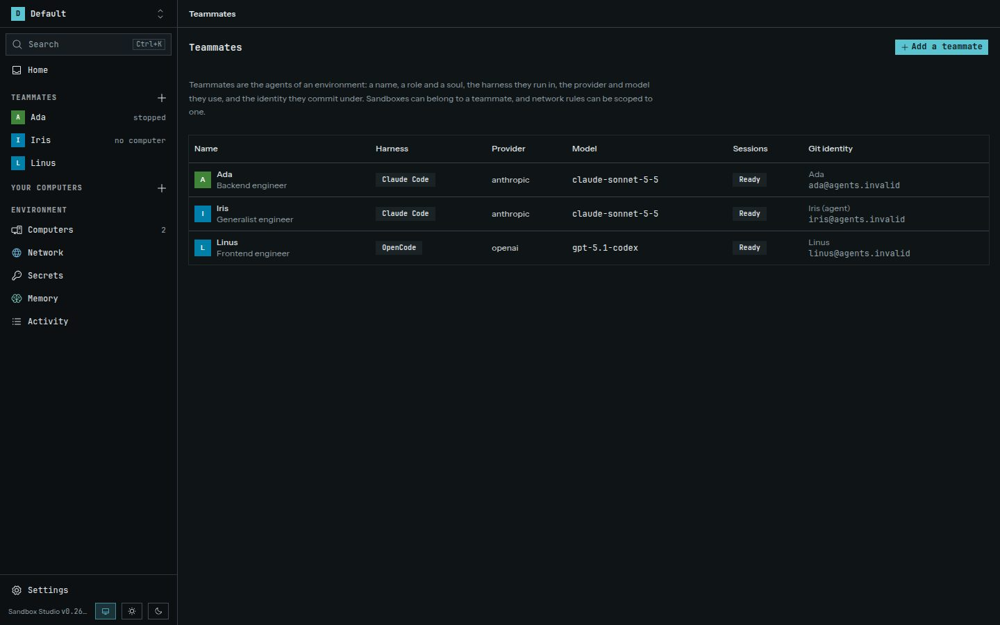
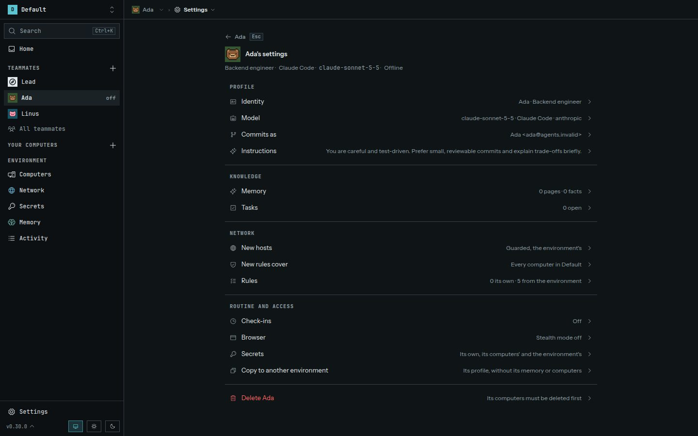
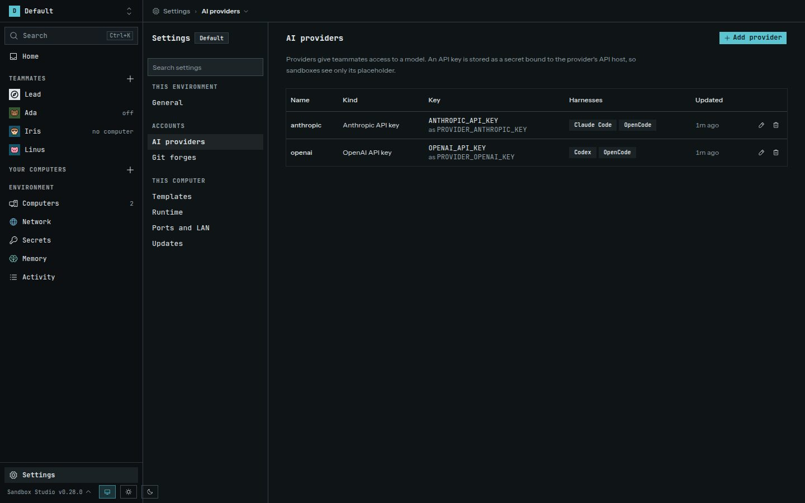

A teammate is an agent identity in one environment. It has a name, role, avatar (an emoji or a generated shape), optional Markdown instructions (“soul”), harness, provider, and a Git name and email, or **Use my git identity** to commit as you do on the Studio machine. Its **Default model** is the one its terminal sessions, check-ins and scheduled tasks use; **Also offered in chats** lists other models of its provider that a chat can pick instead. **New rules from approvals apply to** sets the scope its approval cards preselect: this sandbox, this teammate, or the environment.

One teammate can own several computers. A computer's teammate is picked when it is created or forked, and changes later in the computer's **Details** tab: choose **Change…** in its **Teammate** row while the computer is stopped. The new teammate's rules, secrets and harness settings apply from its next start, while its home, with the harness history and logins in it, stays as it is.

## A teammate's page

Each teammate is listed under **Teammates** in the sidebar, where a word says what it is doing or a number how much waits for you. Its threads are listed under its name; on hover, its row has a terminal button and **+** for a new thread. The **Teammates** heading opens the list of all of them, with **Add a teammate**.

The teammate's page starts on its home:

- **Now**: what waits for you, threads that are running, agents in its terminals, and its browser while it browses, with **Watch**.
- Its threads as cards by day, marked **New** while one has something you haven't seen, with what it learned and its tasks between them.
- Its computers, each with **Terminal**, **Browser** and **Files**, and **Give Iris another computer**. A computer that is off says **Off** and has **Start** (**Resume** for a suspended one); its **Terminal** and **Files** start it too and open once it is up.

The box at the bottom sends a **Thread**, a message that starts a thread on the computer named under it; a **Task**, which goes on its task list and which it starts on right away; or **Teach**, a fact for its memory without a thread. When the teammate offers more than one model, the box also picks the thread's model.

Open one of its computers and it shows beside the home, with its terminal, its browser, a preview of what it serves, its files, its changes and its details (see [the computer's screen](../sandboxes/#the-computers-screen)). The layout switch at the right of the top bar gives the page to the home (**Home only**), to both, or to the computer (**Computer only**). Open a thread to go on with it; the chat takes the home's place, and the button with the teammate's name at the top left, its name in the bar at the top, or Esc, returns to the home. With the computer's screen folded to a strip, a computer that is off has a power button at the top of the strip that starts it without unfolding.

## A teammate's settings

Choose the caret beside the teammate's name in the bar at the top, then **Settings**, or search for *Iris's settings* with ⌘K. The settings are a list of rows, each saying what it is set to and opening to edit it:

- **Profile**: Identity, Agent (harness, provider and models), Git identity, Approvals and Soul.
- **Knowledge**: [Memory](../memory/), with **Learn from its chats** and **Dream every night**, and Tasks.
- **Routine and access**: Check-ins, New hosts (its [network level](../network/#security-levels)), Network rules, [Browser](../browser/), Secrets, and Copy to another environment.

Changes save as you make them: a field saves once you pause typing, and when you close the settings. A change that can't be saved yet, such as an empty name, says so, and closing asks first. **Delete Iris** is at the bottom. **← Iris** above the title, Esc, or the browser's back button returns to where you opened the settings from, such as a thread. ⌘K also finds each row by what it holds, such as *stealth*, *soul* or *check-ins*.

To use the same teammate in another environment, choose **Copy to another environment**. The copy keeps its name, role, avatar, soul, agent, model, git identity and approval setting; its computers, chats, memory, secrets and keys stay behind.

## Choose a provider

Studio supports these providers:

| Provider | Harnesses |
| --- | --- |
| Anthropic API key | Claude Code, OpenCode |
| OpenAI API key | Codex, OpenCode |
| OpenAI-compatible endpoint | Codex, OpenCode |
| Claude Pro/Max subscription | Claude Code |
| ChatGPT Plus/Pro subscription | Codex |

An OpenAI-compatible endpoint needs a base URL and a model; a key is optional. Use `https://` for a hosted service, or `http://` for a server on the Studio machine, such as `http://localhost:11434/v1`, or on your local network. Saving opens that port to the environment's computers, and each connection still asks until a rule allows it. Over plain `http://` on the local network no key is sent. The model field suggests the models the endpoint lists. If you choose Codex, the endpoint must support the OpenAI Responses API.

Tick **The model can see images** if the endpoint's model takes images. It starts off, because many local models read text only. While it is off, the teammate is sent no images: notes you pin on its browser go as text alone, and a chat refuses an attached image with a message that says why.

Claude Pro/Max and ChatGPT subscriptions sign in from the provider dialog: Studio runs the vendor's own login in a short-lived VM and keeps the token on the host; sandboxes get placeholders only. A Claude subscription works in terminal sessions and in chats.

A subscription is not an API key. With an API key you paste the key and are done; with a subscription you sign in with your account in the browser and there is no key to paste. Add the provider, or choose **Sign in** next to it under **Settings → AI providers**, then follow the steps in the dialog:

- **Claude Pro/Max:** open the sign-in page, sign in and choose Authorize, copy the code the page shows, and paste it into the dialog's code field (or press **Paste**). Studio hands the code to Claude Code and saves the sign-in by itself; you don't type into the terminal. **Show the terminal Claude Code runs in** displays what Claude Code says, and opens by itself if it rejects the code. If you'd rather, run `claude setup-token` on your own computer and paste the `sk-ant-oat…` token it prints under **Use a token from claude setup-token instead**.
- **ChatGPT Plus/Pro:** open the sign-in page, enter the code the dialog shows, and sign in. Studio notices when you're done; there is nothing to paste back.

### Logins on this computer

If Claude Code, Codex or opencode is signed in on the computer Studio runs on, the setup and **Settings → AI providers** list it under **On this computer**:

- **Use Claude subscription** and **Use ChatGPT subscription** open the provider dialog with the kind chosen. Studio still signs in on its own and never copies the computer's login, because a copied login that refreshes first signs the computer out. For ChatGPT, the dialog names the account Codex is signed in with, so you can sign in with the same one.
- **Import keys…** lists the credentials opencode stores. Anthropic and OpenAI API keys can be imported one by one; they're sealed in Studio's vault like a typed key, and opencode keeps its own. opencode's subscription sign-ins can't be imported; **Sign in** adds the matching subscription instead.

Until you choose one of these, Studio only checks that the CLIs' files exist and reads nothing in them.

Add or rotate provider keys under **Settings → AI providers**. The key remains in Studio's host-side vault; the guest receives a placeholder, which Studio substitutes only for the provider's bound API host. Provider keys are managed with the provider: the [Secrets](../secrets/) page lists them, marked as provider keys, but changes them only here.

## Default teammate

If an environment has no teammates when you add a provider, Studio adds a teammate named Iris on that provider. Iris is a generalist engineer that uses Claude Code with an Anthropic key or a Claude subscription, Codex with an OpenAI key or a ChatGPT subscription, or OpenCode with a custom endpoint. The Git identity is `Iris (agent) <iris@agents.invalid>`. Iris is an ordinary teammate: you can edit or delete Iris. Studio adds Iris again only when the environment has no teammates and you add another provider.

## Start a teammate session

1. Add a provider and enter its API key, or sign in with a subscription.
2. Choose **+** next to **Teammates** and select a supported harness, provider, and model. A teammate needs a provider for its model: in an environment without one, the dialog says *Add a provider first* and **Add a provider** opens **Settings → AI providers**.
3. Choose **Give Iris a computer** on its page, or create a computer and pick that teammate.
4. Write to the teammate on its page: that starts a thread, a chat. See [Chat](../chat/).
5. To use the harness's own interface instead, choose **Continue in the terminal** in the thread's **⋯**. Studio opens the harness in a new terminal session on the computer's **Terminal** tab.

The provider key must be bound to the correct API host, and the computer must be running. A computer without a teammate still has a terminal, but it cannot start an agent session or use a teammate's memory or browser. Git in it works through the configured forges, and commits use the name and email set in git on the computer running Studio, if it has them.

Studio sets up the harness inside the computer. The teammate's name, role, and soul appear in its managed instruction file. The harness configuration uses the provider placeholder; it does not contain the real key. Changes to the teammate instructions take effect on the next session start.

## Tasks and check-ins

The teammate's tasks, under **Tasks** in its settings (or ⌘K, *Iris's tasks*), list the work it should do. A task has a title, optional details in Markdown, and an optional due day. You add, edit, and mark tasks done; the teammate can add tasks to its own list while it works.

Check-ins are off until you turn them on in the teammate's settings. With check-ins on, Studio gives the teammate a chat turn every few hours, during the hours you pick, whenever it has open tasks. The turn runs on the teammate's most recent computer, and its thread is marked **Check-in**. If that computer is stopped, Studio starts it for the check-in, and it keeps running afterwards.

A check-in that can't run is listed under **Activity** in the teammate's tasks with the reason: the teammate has no computer, its provider has no key, approvals are waiting on its computer, or its computer isn't ready.

A task can also get a schedule of its own in its dialog: once at a day and time, on some weekdays at a time, or every few hours inside a window. At each time Studio starts a new chat for that task on the teammate's latest computer, or the one you pick, and the chat list marks it as scheduled. If the teammate is busy then, the run waits up to 30 minutes. Each run starts with a clean chat, so the teammate keeps what the next run should know in the task's notes. Check-ins leave scheduled tasks to their own runs. The task list shows each schedule and its next run, and **Run now** starts a run at once. Runs, including the skipped and missed ones, are listed under **Activity**. Only you set schedules; the teammate can't.

## Ownership and deletion

Teammate rules apply only to the computers that teammate owns. A teammate with computers cannot be deleted until those computers are deleted or given another teammate on their **Details** tab. Deleting a teammate also removes its teammate-scoped network rules.
