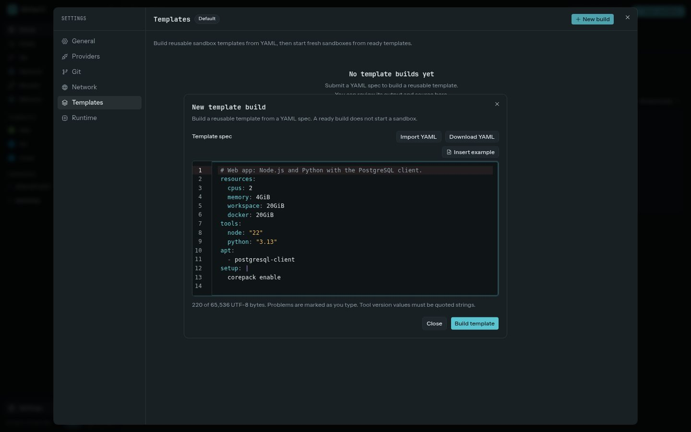

A template describes the software in a sandbox's root filesystem. Its YAML can set CPU, memory, workspace, and Docker sizes; install Node.js, Python, Go, or Nix; install apt packages; and run a setup script.



## Example

New builds start from this Web app template. **Insert example** in the editor puts it back.

```yaml
resources:
  cpus: 2
  memory: 4GiB
  workspace: 20GiB
  docker: 20GiB
tools:
  node: "22"
  python: "3.13"
apt:
  - postgresql-client
setup: |
  corepack enable
```

Quote tool versions. The currently supported tools are `go`, `node`, `nix`, and `python`. `nix` takes only the Nix releases Studio pins, currently 2.35.1. Resource sizes use `MiB`, `GiB`, or `G`; CPU counts are whole numbers. `resources` also takes `home`, the size of the disk that holds `/home/agent` with the agents' sessions and caches; it is 4 GiB unless you name another.

## Importing YAML does not run it

**Import YAML** only loads the file into the editor. It does not submit the spec, create a VM, or execute commands. Review the text, then select **Build template** when you want Studio to run the build.

As you type, the editor highlights the YAML, suggests keys, tool names, and size units, and marks each problem at its line and column. These checks use the same parser as the build and create nothing.

After you submit a build, Studio runs the apt installs, language tool installs, and `setup` script in a temporary builder VM. Apt runs as root; the setup script runs as the `agent` user. Treat `setup` as executable shell code. You can follow the job status and read its bounded log on **Settings → Templates**. A successful template is cached for later builds. **A ready build does not start a sandbox**; choose **Create sandbox** separately when you want to use it.

**Download YAML** saves the draft or the source submitted for a build. It does not export a built image, secrets, or sandbox disks.

## Create a sandbox from a template

On **Settings → Templates**, open a ready build and choose **Create sandbox** on its sheet or its page. Studio boots a new sandbox using the template's root filesystem. The new sandbox has a fresh, empty `/workspace` and Docker disk, and a home directory seeded from the template; it does not inherit a previous sandbox's files or containers.

Template builds and ready templates belong to one environment. A ready template can also be used when rebasing a sandbox. Rebase carries over `/workspace`, but drops Docker data and terminal sessions. A template built on an older base image than this Studio's has **Rebuild on the current base**, which builds the same spec again as the template's next version. See [Sandboxes](../sandboxes/).
